# Malicious URL Detection with a Random Forest and Gradient Boosting — Technical Documentation

*Last updated: 2026-11-25. Every result below is copied from `reports/metrics.json`,
`reports/external_eval.json`, `reports/red_team.json` or `data/processed/prepare_report.json`,
which the scripts regenerate on each run. Figures that are not model results (memory use, request times) are
labelled as measurements.*

- **Live demo:** https://malicious-url-detector-33wl.onrender.com (free plan; the first visit after a quiet spell takes about a minute)
- **Source code:** https://github.com/MehrabSD/Url-Detection-using-Random-Forest

This document has four parts:

- **Part A — What was built and how well it works** (sections 1–11): data, features, model,
  results, the red-team attack and its fix, limitations. Read this to understand the project.
- **Part B — Building it from scratch** (sections 12–16): environment, every script in order,
  the algorithms behind them with the key code, and how to check each step worked.
- **Part C — The demo website and deployment** (sections 17–19): how the page and its server
  work, the API, testing, and putting it online.
- **Part D — For placements** (sections 20–24): what the project teaches, resume lines, how to
  pitch it, and interview questions with answers.

Appendices: full feature reference, troubleshooting, glossary, change log, references.

## Contents

- [1. Summary](#1-summary)
- [2. Pipeline](#2-pipeline)
- [3. Datasets](#3-datasets)
- [4. Data preparation](#4-data-preparation-prepare_datapy)
- [5. Why evaluation is done on unseen sites](#5-why-evaluation-is-done-on-unseen-sites)
- [6. Train / validation / test split](#6-train--validation--test-split)
- [7. Features](#7-features)
- [8. Model](#8-model)
- [9. Results on the test sites](#9-results-on-the-test-sites)
- [10. Limitations](#10-limitations)
- [11. Possible improvements](#11-possible-improvements)
- [12. Prerequisites and setup](#12-prerequisites-and-setup)
- [13. Project layout and data flow](#13-project-layout-and-data-flow)
- [14. Step-by-step build](#14-step-by-step-build)
- [15. The algorithms, explained with the code](#15-the-algorithms-explained-with-the-code)
- [16. Design decisions and the alternatives rejected](#16-design-decisions-and-the-alternatives-rejected)
- [17. The demo website](#17-the-demo-website)
- [18. Testing](#18-testing)
- [19. Deployment](#19-deployment)
- [20. What this project teaches](#20-what-this-project-teaches)
- [21. Resume lines](#21-resume-lines)
- [22. Explaining the project in an interview](#22-explaining-the-project-in-an-interview)
- [23. Interview questions and answers](#23-interview-questions-and-answers)
- [24. Concepts to revise before an interview](#24-concepts-to-revise-before-an-interview)
- [Appendix A. Feature reference](#appendix-a-feature-reference)
- [Appendix B. Troubleshooting](#appendix-b-troubleshooting)
- [Appendix C. Glossary](#appendix-c-glossary)
- [Appendix D. Tools used during development](#appendix-d-tools-used-during-development)
- [Change log](#change-log)
- [References](#references)

---

# Part A — What was built and how well it works

## 1. Summary

The project reads a URL **as text only** and decides whether it is benign or malicious
(phishing, malware delivery or a defaced page). It never visits the site. The model is a
**random forest averaged with a gradient-boosted model**: two tree ensembles that read the same
56 features and make different kinds of mistakes.

| | |
|---|---|
| Training corpus | 1,654,727 unique URLs from three public datasets, 698,917 distinct sites |
| Features | 56 per URL: 53 fixed lexical measurements + 3 learned from training labels |
| Model | random forest (200 trees, depth ≤ 25) averaged with gradient boosting (600 rounds of 63-leaf trees); 90.4 MB on disk |
| Test set | 372,253 URLs from 139,996 sites that the model **never saw** during training |
| Accuracy | **88.7 %** |
| Precision / Recall / F1 | **0.840 / 0.820 / 0.830** |
| ROC-AUC / PR-AUC | **0.946 / 0.924** (the forest alone: 0.941 / 0.916) |
| Check on a fourth, independent dataset | 86.9 % accuracy, F1 0.824, ROC-AUC 0.942 on 5,839 URLs from sites absent from training (section 9.4) |
| Speed | about 0.55 ms per URL in batches, feature extraction included (measured by `train.py` while the laptop was also busy with other programs) |
| **Red team (section 9.5)** | an automated attacker slipped **83.1 %** of the caught phishing URLs past the model with **one free edit** (400 URLs from unseen sites, external dataset) |
| **Defence (section 9.6)** | multi-view scoring cuts that to **12.7 %** with no retraining; on the external dataset F1 0.824 → 0.816 and false alarms 13.9 % → 13.1 %; on validation F1 0.866 → 0.842 |
| Extra layers | a rule-based lookalike-domain check (typosquats, homoglyphs, punycode; section 9.7), inbox triage of whole messages, and QR-code reading (section 17) |
| Demo | a web page that scores a URL as it is typed, explains the verdict, attacks it live and checks whole messages (section 17), hosted free on Render from a compact copy of the model (304 MB peak memory, identical predictions; section 19) |
| Links | live: https://malicious-url-detector-33wl.onrender.com · code: https://github.com/MehrabSD/Url-Detection-using-Random-Forest |

These figures are lower than the 97–99 % often quoted for this task. Section 5 shows why: the
usual evaluation lets the same websites appear in both training and test data, and the most
popular dataset labels its classes with a formatting quirk a model can read directly. Both
shortcuts were removed here, so the numbers describe performance on genuinely new websites.

**What sets this project apart: it attacks itself.** Most detectors are evaluated on a fixed
test set, as if attackers never reacted. This one ships with a red team (`adversary.py`) that
plays the attacker: given a flagged link, it searches the edits real campaigns make — move to a
`.com`, drop the word *login*, add newsletter tracking tags — each with a price to the attacker,
and finds the cheapest version that would pass. Run over 400 phishing URLs it exposed a real
blind spot (one free edit beat the model 83.1 % of the time), traced it to its cause (the
strongest feature averages its evidence, so padding dilutes it), and measured a fix that needs
no retraining (section 9.6). The same search runs live on the demo page, so a visitor can watch
a link being disguised step by step and then watch the hardened scorer resist it.

**How the model was chosen.** The project started as a single random forest. Before changing
it, the alternatives were measured on the validation sites and the external dataset only, with
the test sites left untouched: gradient boosting, stacking a booster on the forest (section
9.8), and combining the forest with k-nearest neighbours and SVMs (section 9.9). Only one change
held up on both: averaging the forest with a gradient-boosted model. It was adopted (section
8.3); on the test sites it raised F1 from 0.824 to 0.830 and caught
66.3 % instead of 63.0 % of malicious URLs in the strict ≤ 1 % false-alarm mode.

## 2. Pipeline

```
download_data.py    4 public datasets            -> data/raw/
prepare_data.py     normalise, clean, dedupe,
                    extract 53 features          -> data/processed/dataset.parquet
train.py            experiments, learned features,
                    search, final forest + booster -> models/malicious_url_rf.joblib
                                                    reports/metrics.json
make_figures.py     charts from the JSON reports -> reports/figures/*.png
evaluate_external.py  score the saved model on a
                    dataset it was not built from -> reports/external_eval.json
red_team.py         attack the model, calibrate and
                    measure the multi-view defence,
                    evaluate the lookalike check  -> reports/red_team.json
compact_forest.py   the model as flat arrays      -> models/malicious_url_rf.npz
                    (run by train.py; served by the demo)
predict.py          score new URLs (command line / Python; --hardened)
serve.py            demo web page (web/) on top of the saved model and reports
```

Supporting modules: `features.py` (the 53 fixed features), `learned_features.py` (the 3
learned ones), `explain.py` (explains one prediction for the page) and `describe.py` (plain
labels for the page), plus the four added layers: `adversary.py` (attacker edits and the
search), `hardening.py` (multi-view scorer), `lookalike.py` (brand-impersonation rules) and
`triage.py` (finds every link in a message). The whole pipeline takes roughly 30 minutes on a
16-core laptop with 16 GB RAM (15 for training, 15 for the red team).

## 3. Datasets

| Dataset | Raw rows | Labels | Licence | Obtained from |
|---|---|---|---|---|
| **Kaggle "Malicious URLs"** (sid321axn) | 651,191 | benign, phishing, malware, defacement | CC0 | Hugging Face mirror `surajshelke/malicious_url` (row count matches the Kaggle original exactly; Kaggle itself needs an API key) |
| **PhiUSIIL Phishing URL** (UCI id 967; Prasad & Chandra 2024) | 235,795 | legitimate, phishing | CC BY 4.0 | archive.ics.uci.edu |
| **Site-aware URL benchmark** (`JPxxx/url-benchmark-dataset`) | 2,999,995 | benign, malicious | Apache-2.0 | Hugging Face |
| **Hannousse & Yahiouche (2021)** — *test only* | 11,430 | legitimate, phishing | CC BY 4.0 | Hugging Face `pirocheto/phishing-url`; never used for training (section 9.4) |

From the benchmark, all 299,995 malicious URLs and a random 600,000 of the 2.7 M benign URLs
were used, to keep training within laptop memory and stop one source dominating.

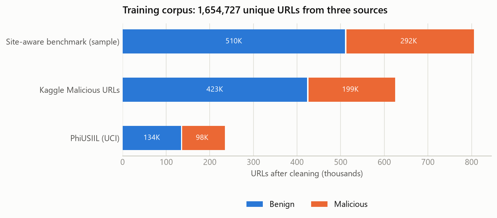

After cleaning (section 4) the corpus is 64.5 % benign and 35.5 % malicious:

| Source | Benign | Malicious |
|---|---|---|
| Benchmark (sample) | 509,986 | 292,101 |
| Kaggle | 422,914 | 198,520 (95,284 defacement, 79,645 phishing, 23,591 malware) |
| PhiUSIIL | 133,621 | 97,585 (all phishing) |

### Problems found in the raw data

Inspecting the data before modelling turned up three problems that shaped the design.

1. **The URL scheme gives away the label in the Kaggle set.** Only 8.3 % of its benign URLs
   start with `http`, against 100 % of defacement and 96.3 % of malware URLs. The one-line rule
   "malicious if it starts with http" already scores **83.7 % accuracy** on that dataset. This is
   an accident of how the lists were collected, not something true of real traffic.
2. **PhiUSIIL's legitimate URLs are all bare home pages** of the form `https://www.site.com`
   (100 % https, 100 % `www.`, 0 % with a path), while its phishing URLs are varied. Again a
   collection artifact.
3. **The Kaggle phishing label is noisy.** 13,266 Kaggle "phishing" rows are the same URL that
   Kaggle itself or another source labels benign (examples: `tools.ietf.org/html/rfc176`,
   `www.panasonic.com/business/office/cat_printers.asp`).

The lesson generalises: **look at the raw data before modelling.** A model trained on the
Kaggle set as shipped would score highly by learning the `http` prefix, and fail in use.

## 4. Data preparation (`prepare_data.py`)

**Normalisation.** Every URL is rewritten to a canonical form before anything else:
the scheme (`http://`, `https://`) is removed, a leading `www.` is removed, the host is
lower-cased, and a bare trailing `/` is dropped. This removes artifacts 1 and 2 above and makes
the three sources comparable (the benchmark ships its URLs already stripped this way).
The cost is that the model cannot use "is it HTTPS?" as a signal — acceptable, because in these
datasets that signal reflects the collector, not the attacker.

**Cleaning**, in order, starting from 1,786,981 rows:

| Step | Rows removed |
|---|---|
| Junk (shorter than 4 characters, no dot, whitespace or control characters) | 627 |
| URLs appearing with **both** labels — removed entirely as ambiguous | 26,730 |
| Exact duplicates after normalisation (first occurrence kept) | 104,897 |
| **Remaining** | **1,654,727** |

The demo page applies the same junk rule to what a visitor types (section 17.3), because the
model never saw such text and its score for it would mean nothing.

**Site identifier.** Each URL is assigned its *registered domain* (`mail.example.co.uk` →
`example.co.uk`; an IP address stands for itself) using the public-suffix list bundled with
`tldextract`, with no network access. A stable MD5 hash of that domain puts each site in one of
ten buckets. Buckets drive the train/validation/test split in section 6.

## 5. Why evaluation is done on unseen sites

Two diagnostic experiments were run with a 100-tree forest on the 53 fixed features.

### 5.1 Random split versus site-disjoint split

On the Kaggle data alone, the same model was evaluated two ways.

| Split | Accuracy | F1 | Recall | ROC-AUC |
|---|---|---|---|---|
| Random 80/20 (the usual method) | 0.907 | 0.844 | 0.787 | 0.965 |
| Site-disjoint (no test site in training) | 0.864 | 0.719 | 0.633 | 0.912 |

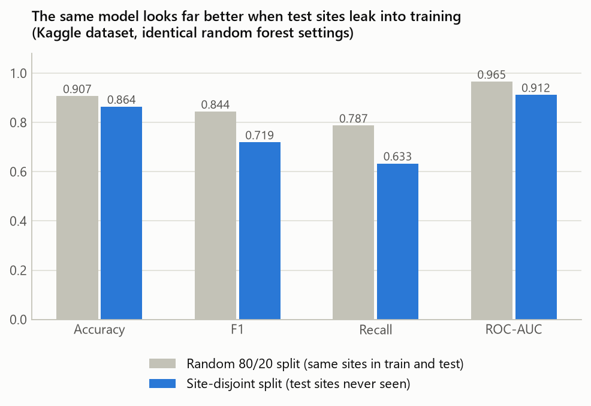

In the random split, **80.3 % of test URLs belong to a site that is also in the training set**.
The model partly recognises sites it has met rather than recognising malicious structure, which
inflates F1 by about 12 points. A deployed detector mostly faces sites it has never seen (known
bad sites are handled by blocklists), so the site-disjoint number is the honest one.

### 5.2 Cross-dataset transfer

A model was trained on one source and tested on unseen sites from each source (F1):

| Trained on ↓ / tested on → | Kaggle | PhiUSIIL | Benchmark |
|---|---|---|---|
| Kaggle | 0.72 | 0.55 | 0.37 |
| PhiUSIIL | 0.43 | 0.88 | 0.58 |
| Benchmark | 0.33 | 0.73 | 0.91 |
| All three | 0.64 | 0.81 | 0.89 |

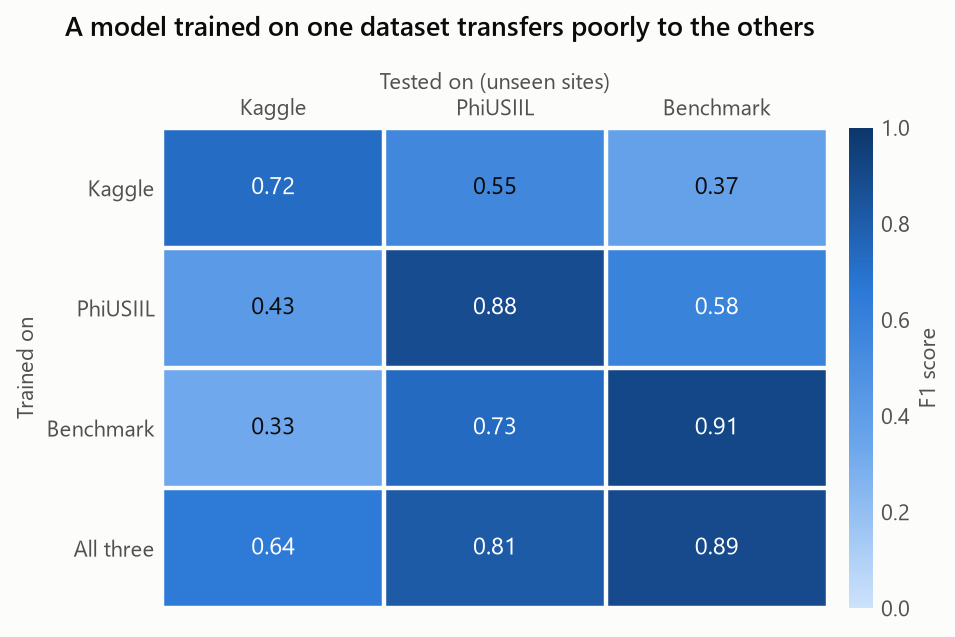

A model trained on a single dataset largely learns that dataset's habits and transfers poorly.
Training on all three gives the best balance across sources, at a small cost on each home
dataset. This is why the final model uses the merged corpus.

## 6. Train / validation / test split

| Part | Buckets | URLs | Sites | Malicious share | Used for |
|---|---|---|---|---|---|
| Train | 3–9 | 1,126,862 | 489,138 | 35.7 % | fitting |
| Validation | 2 | 155,612 | 69,783 | 38.8 % | hyper-parameters, decision threshold |
| Test | 0–1 | 372,253 | 139,996 | 33.7 % | final score, used once |

No registered domain appears in more than one part. This is a **group split** (the group is the
site), the same idea as scikit-learn's `GroupShuffleSplit`, but done with a hash so that every
script, on any machine, puts every site in the same part without storing a list.

## 7. Features

### 7.1 The 53 fixed lexical features (`features.py`)

All are computed from the normalised URL string in about 40 µs. Appendix A defines each one.

| Group | Features | Why it can matter |
|---|---|---|
| Whole URL (22) | `url_length`; counts of `.` `-` `_` `/` `?` `=` `&` `@` `%`; `n_digits`, `n_letters`, `n_special`; `digit_ratio`, `special_ratio`, `uppercase_ratio`; `url_entropy`; `longest_digit_run`; `n_hex_escapes`; `has_embedded_url`; `n_suspicious_words`; `brand_outside_domain` | Malicious URLs tend to be longer, more random and heavier in digits and symbols; they hide redirects and use urgency words (`login`, `verify`, `account`…). `brand_outside_domain` fires when a brand such as *paypal* appears anywhere except the registered domain (`paypal.com.evil.xyz`). |
| Host (18) | `host_length`, `host_is_ip`, `has_port`, `has_userinfo`, `n_subdomains`, `domain_length`, `tld_length`, `host_n_digits`, `host_n_hyphens`, `host_entropy`, `host_longest_label`, `domain_digit_ratio`, `domain_vowel_ratio`, `tld_is_common`, `tld_is_country`, `tld_is_suspicious`, `is_shortener`, `has_punycode` | Raw IPs, odd ports, deep subdomain chains, machine-generated names (few vowels, many digits), cheap TLDs and look-alike punycode are classic attacker choices. |
| Path (9) | `path_length`, `path_depth`, `path_longest_segment`, `path_n_digits`, `path_has_double_slash`, `ext_exec`, `ext_script`, `ext_html`, `ext_archive` | Malware links end in executables (`.exe`, `.apk`, `.sh`, IoT-botnet binaries); phishing kits sit in deep, long paths. |
| Query / fragment (4) | `query_length`, `n_query_params`, `query_longest_value`, `has_fragment` | Long tracking tokens and redirect parameters. |

Entropy is Shannon entropy of the character distribution, `H = −Σ pᵢ log₂ pᵢ`; random-looking
strings score higher.

### 7.2 The 3 learned features (`learned_features.py`)

Fixed formulas cannot say whether `secure-acc0unt-verify` *reads like* names attackers choose.
Three small statistical models, fitted on the training labels, supply that.

| Feature | Definition |
|---|---|
| `tld_malicious_rate` | Share of training **sites** under this TLD that are malicious, smoothed toward the overall rate: `(malicious_sites + prior·20) / (sites + 20)`. Counted per site so one huge domain cannot dominate its TLD. (This is *target encoding* with smoothing.) |
| `host_ngram_score` | Naive-Bayes log-odds of the host name, using character 2–4-grams. |
| `url_ngram_score` | The same over the whole URL, using character 3–5-grams. |

For the n-gram scores, each n-gram `g` gets a weight
`w(g) = log P(g | malicious) − log P(g | benign)` with additive smoothing α = 0.1, and the
feature is the average weight over the string's n-grams. N-grams are hashed into 2²⁰ slots so no
vocabulary needs storing.

**Avoiding self-leakage (out-of-fold scores).** If a training URL's own label helped build the
score it receives, the score would look far more reliable in training than it is on new data,
and the trees would over-trust it. So each training row is scored by a model built from the
**other six training buckets** (sites it does not belong to). Because Naive Bayes is just
counts, "everything except bucket *b*" is the total minus bucket *b*'s counts, so no refitting is
needed. Validation, test and new URLs are scored by the model built from all seven buckets.

## 8. Model

The model is two tree ensembles whose probabilities are averaged:

- A **random forest** trains many deep decision trees, each on a random sample of rows and
  considering a random subset of features at every split, then averages their votes. Averaging
  cancels the individual trees' overfitting (it lowers *variance*).
- A **gradient-boosted model** grows small trees one after another; each new tree is fitted to
  the errors the trees before it still make, and its output is added to theirs (it lowers
  *bias*).

Both suit this problem because the features are a mix of counts, ratios and flags on very
different scales (trees need no scaling), their interactions matter (a long query is fine on a
search engine and suspicious on a raw IP), and both train in minutes on a million rows. Because
one averages independent deep trees and the other adds shallow corrections, they make
different mistakes, which is what makes their average better than either on data from a new
source (sections 8.3, 9.4). The forest was the project's original model; the booster was added
after the experiment in section 9.8.

### 8.1 Hyper-parameter search

Nine configurations were fitted on the training part (60 trees each) and scored on validation.

| Configuration | Val PR-AUC | Val F1 | Nodes per tree |
|---|---|---|---|
| scikit-learn defaults | 0.9349 | 0.8590 | 202,205 |
| leaf ≥ 2, 30 % sample | 0.9380 | 0.8590 | 59,595 |
| leaf ≥ 5, 30 % sample | 0.9380 | 0.8569 | 33,505 |
| leaf ≥ 5, 50 % sample | **0.9393** | 0.8583 | 49,023 |
| leaf ≥ 10, 50 % sample | 0.9383 | 0.8568 | 30,521 |
| **leaf ≥ 3, 20 % sample, depth ≤ 25** | 0.9381 | 0.8567 | **24,821** |
| leaf ≥ 5, 30 % sample, 30 % of features per split | 0.9376 | 0.8557 | 34,286 |
| leaf ≥ 5, 30 % sample, entropy criterion | 0.9386 | 0.8570 | 33,223 |
| leaf ≥ 5, 30 % sample, balanced class weights | 0.9376 | 0.8588 | 34,818 |

All regularised options score within 0.002 PR-AUC of each other, so the rule was: **among
configurations within 0.002 of the best, take the smallest forest.** The chosen one is an eighth
the size of the defaults and slightly more accurate — fully grown trees memorise noise.

Final parameters: `n_estimators=200, max_depth=25, min_samples_leaf=3, max_samples=0.2,
max_features="sqrt", criterion="gini"`. Each tree has about 24,900 nodes.

### 8.2 Number of trees

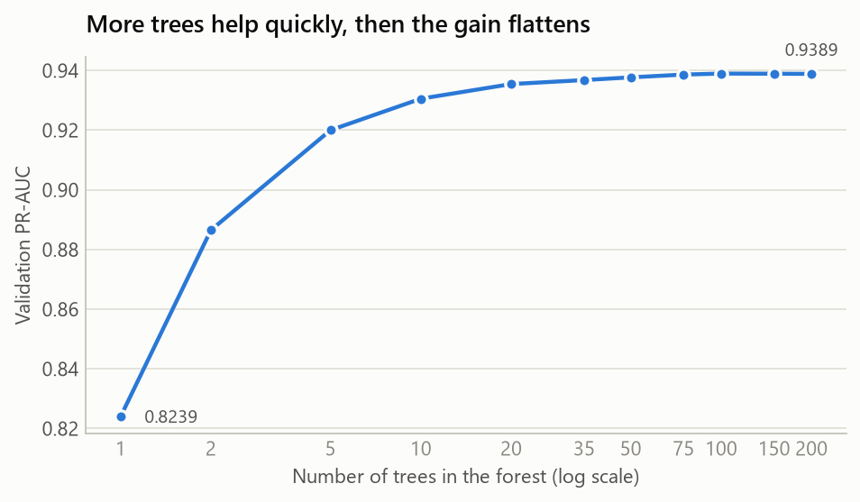

Validation PR-AUC rises from 0.824 with one tree to 0.935 at 20 and is flat from about 100
(0.9390) to 200 (0.9389). 200 was kept for stable scores; 100 would halve the file size at no
measurable loss.

### 8.3 The gradient-boosted half

scikit-learn's `HistGradientBoostingClassifier` (the LightGBM algorithm: each feature is first
binned into at most 255 values, which makes split search fast), with the settings of the stacking
experiment: trees of up to 63 leaves, learning rate 0.1, at least 50 rows per
leaf, L2 regularisation 1.0, no early stopping. It is trained on the same rows and the same 56
features as the forest, including the out-of-fold learned features.

The number of boosting rounds was chosen on the validation sites by the PR-AUC of the
**average** with the forest, the model actually used, checked every 25 rounds up to 600:

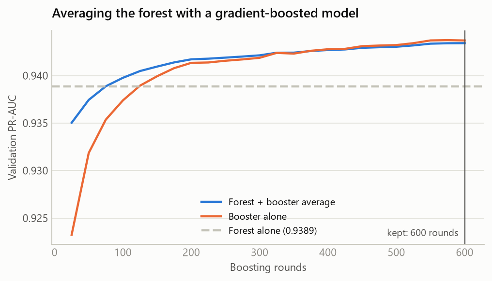

| Validation PR-AUC | 100 rounds | 300 rounds | 500 rounds | 600 rounds (kept) |
|---|---|---|---|---|
| Gradient boosting alone | 0.9374 | 0.9419 | 0.9432 | 0.9437 |
| Average with the forest | 0.9398 | 0.9421 | 0.9430 | 0.9434 |
| Random forest alone | 0.9389 | | | |

The curve is flat from about 550 rounds, so the limit of 600 is not holding the model back.
On the validation sites the booster alone and the average are level; the average was chosen
because on the external dataset of other people's URLs it was the more robust of the two
(section 9.8, and confirmed in section 9.4), and because it keeps the forest's tree vote and
exact explanation on the page. The model was refitted with exactly 600 rounds (no early
stopping and no sampling, so the refit is deterministic; `train.py` asserts it equals the
long fit). Fitting the booster and choosing its rounds took 11 minutes on this run.

The score is

```
score = ( forest probability + booster probability ) / 2
```

with equal weights, fixed in advance rather than tuned, so there is nothing more to overfit.

### 8.4 Decision threshold

The model outputs a score from 0 to 1. Three cut-offs, chosen on validation data, are stored
with the model:

| Mode (`predict.py --mode`) | Threshold | Purpose |
|---|---|---|
| `balanced` (default) | 0.422 | maximises F1 on validation |
| `default` | 0.500 | plain majority vote |
| `strict` | 0.807 | at most 1 % of benign validation URLs flagged |

## 9. Results on the test sites

| Mode | Accuracy | Precision | Recall | F1 | False-positive rate |
|---|---|---|---|---|---|
| balanced (0.422) | 0.887 | 0.840 | 0.820 | 0.830 | 7.9 % |
| default (0.500) | 0.891 | 0.868 | 0.797 | 0.831 | 6.1 % |
| strict (0.807) | 0.879 | 0.967 | 0.663 | 0.786 | 1.2 % |

Threshold-free: ROC-AUC 0.946, PR-AUC 0.924. The forest alone had
0.941 and 0.916, and in strict mode it caught 63.0 % of malicious URLs against
66.3 % now, at the same ≈ 1 % false alarms.

The validation-tuned threshold did not beat 0.5 on the test set (F1 0.8301 vs
0.8311); the two are equivalent in practice. Validation F1 was 0.866, test
0.830 — the test bucket happens to be harder, mostly through more benign URLs being flagged.

**How often the test sites were used.** They were scored once by the original forest-only
model, for the first version of this document. The booster was then chosen on validation and
external data only (sections 9.8 and 8.3) and the test sites were scored once more, to report
the adopted model; nothing was tuned on them in between. The forest's own test result is kept in
the comparison below.

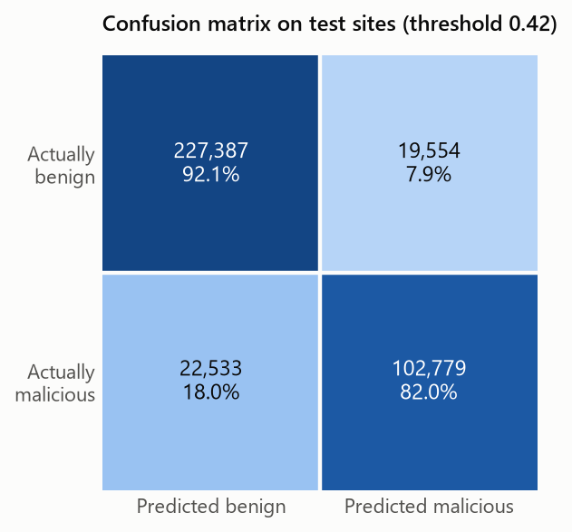

At the balanced threshold: 227,387 benign URLs correctly passed, 19,554 benign flagged,
102,779 malicious caught, 22,533 malicious missed.

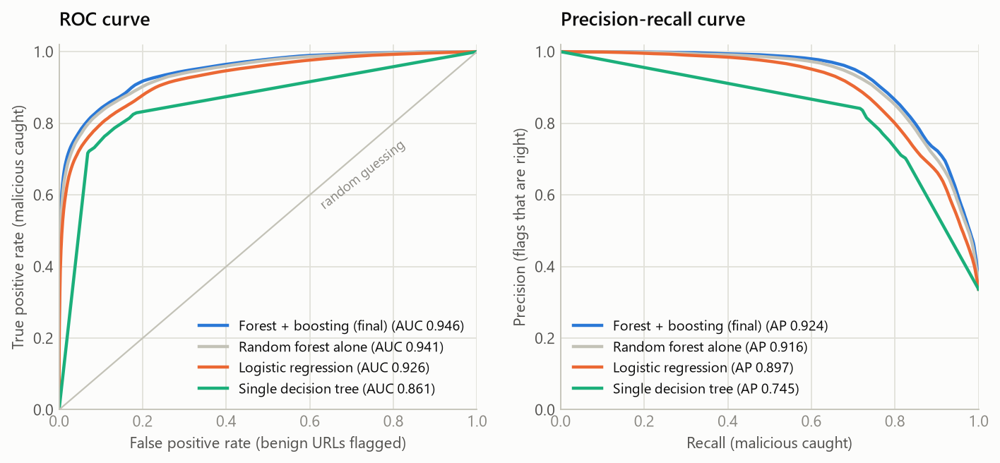

### 9.1 Comparison with other models

All trained on the same rows and features, scored at the 0.5 cut-off on the same test sites.

| Model | Accuracy | Precision | Recall | F1 | ROC-AUC |
|---|---|---|---|---|---|
| Always predict benign | 0.663 | – | 0.000 | 0.000 | 0.500 |
| Single decision tree | 0.843 | 0.761 | 0.779 | 0.770 | 0.861 |
| Random forest, 53 fixed features only | 0.871 | 0.875 | 0.719 | 0.789 | 0.911 |
| Logistic regression (56 features) | 0.872 | 0.839 | 0.767 | 0.802 | 0.926 |
| Random forest, all 56 features (the original model) | 0.887 | 0.861 | 0.792 | 0.825 | 0.941 |
| Gradient boosting, all 56 features | 0.891 | 0.869 | 0.798 | 0.832 | 0.948 |
| **Forest + gradient boosting average (final)** | **0.891** | **0.868** | **0.797** | **0.831** | **0.946** |

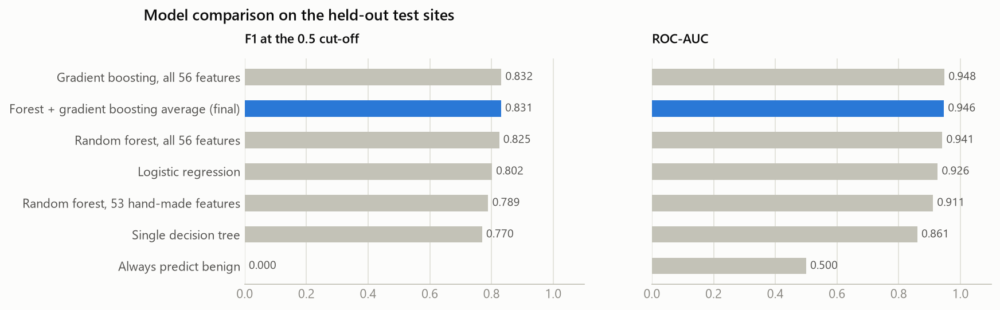

- **Averaging with the booster** adds 0.6 F1 points, 0.005 ROC-AUC and
  0.007 PR-AUC over the forest alone.
- **On these test sites the booster alone is marginally ahead of the average** (F1
  0.8318 against 0.8311, ROC-AUC 0.9483 against 0.9465). The choice between them was made
  before the test sites were scored: level on validation, and the average ahead on the external
  dataset (section 9.4). Switching now would be choosing a model on the test set, so the
  average stays; both gaps are under 0.002.
- The forest beats a single tree by 5.5 F1 points and 0.08 ROC-AUC: the benefit of averaging.
- The three learned features add 3.6 F1 points and 0.03 ROC-AUC to the forest over the fixed features alone.
- Logistic regression on the same 56 features is 3.0 F1 points behind the final model. Much of the
  signal sits in the n-gram score, which a linear model can use directly; the trees' advantage is
  in combining it with the structural features.
- "Always predict benign" scores 66.3 % accuracy while catching nothing — why accuracy alone is
  a poor measure here.

### 9.2 By dataset and attack type (balanced threshold)

| Test subset | URLs | Precision | Recall | F1 | False-positive rate | ROC-AUC |
|---|---|---|---|---|---|---|
| Benchmark | 162,419 | 0.895 | 0.941 | 0.917 | 5.9 % | 0.981 |
| PhiUSIIL | 51,805 | 0.966 | 0.815 | 0.884 | 2.7 % | 0.946 |
| Kaggle | 158,029 | 0.698 | 0.666 | 0.682 | 11.0 % | 0.903 |

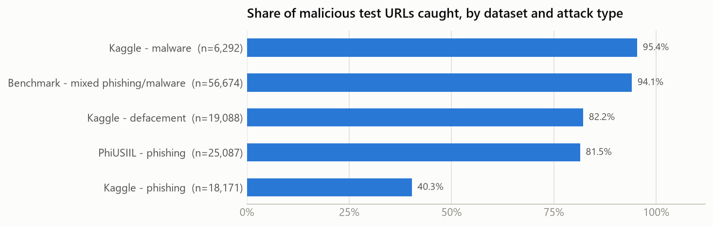

| Malicious kind | Test URLs | Caught |
|---|---|---|
| Kaggle – malware | 6,292 | 95.4 % |
| Benchmark – mixed phishing/malware | 56,674 | 94.1 % |
| Kaggle – defacement | 19,088 | 82.2 % |
| PhiUSIIL – phishing | 25,087 | 81.5 % |
| Kaggle – phishing | 18,171 | 40.3 % |

Malware URLs (raw IPs, executable file names) are easy. Kaggle phishing is the weak spot, and
much of that is the label noise described in section 3: the most confidently "missed" phishing
URLs are ordinary articles such as `arstechnica.com/gaming/news/2010/08/...`.

### 9.3 Feature importance

Permutation importance: shuffle one feature across 20,000 test URLs and measure the fall in the
final model's PR-AUC. Impurity importance (how much each feature reduces Gini impurity during
training, inside the forest only — the booster has no equivalent stored) is shown for comparison.

| Rank | Feature | Permutation (PR-AUC drop) | Impurity share (forest) |
|---|---|---|---|
| 1 | `url_ngram_score` | 0.3164 | 0.342 |
| 2 | `tld_malicious_rate` | 0.0207 | 0.071 |
| 3 | `host_ngram_score` | 0.0144 | 0.102 |
| 4 | `path_depth` | 0.0116 | 0.012 |
| 5 | `url_length` | 0.0046 | 0.022 |
| 6 | `host_length` | 0.0029 | 0.028 |
| 7 | `n_letters` | 0.0028 | 0.019 |
| 8 | `domain_length` | 0.0027 | 0.015 |
| 9 | `path_n_digits` | 0.0025 | 0.006 |
| 10 | `longest_digit_run` | 0.0024 | 0.009 |

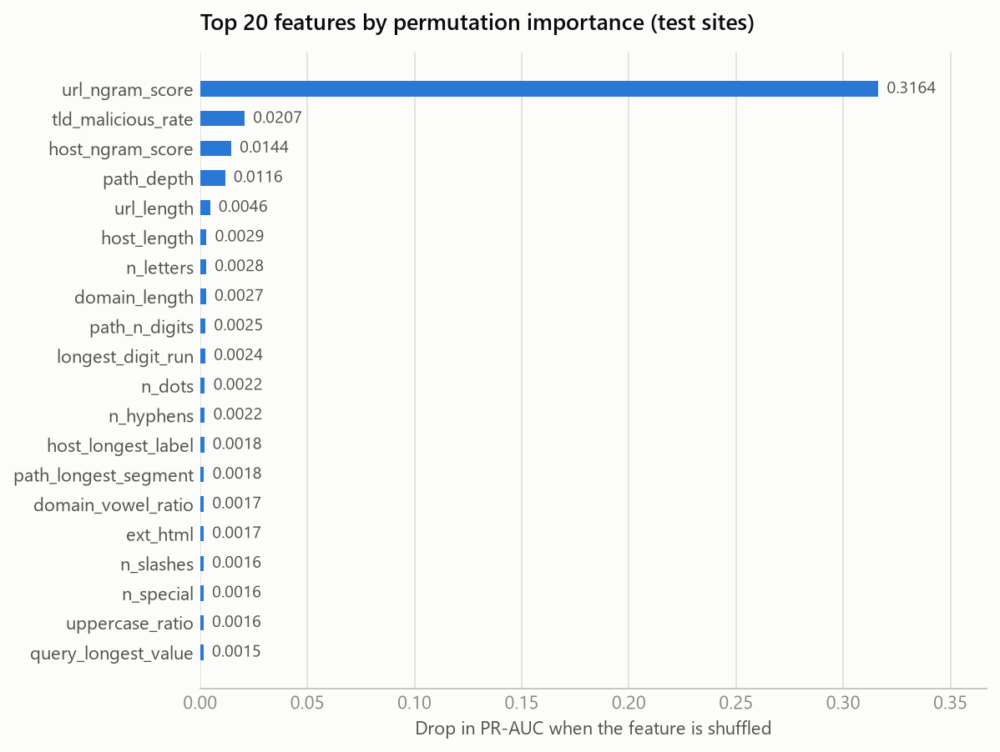

The whole-URL n-gram score dominates. The small permutation values for the fixed features do
not mean they are useless — many are correlated (length, letter count, path length), so
shuffling one lets the others cover for it; together they still reach ROC-AUC 0.911 on their own.

### 9.4 External check on a fourth dataset (`evaluate_external.py`)

The test sites above come from the same three sources as the training data. To see whether the
model holds up on data collected by someone else, the saved model was scored, unchanged, on the
**Hannousse & Yahiouche (2021) phishing benchmark**: 11,430 URLs, exactly half phishing and
half legitimate, CC BY 4.0. Nothing was fitted or tuned on it; the thresholds are the ones
chosen in section 8.4.

After the same cleaning as section 4 (3 junk rows and 200 duplicates removed) 11,227 URLs
remain. This dataset is **not** fully independent of the training corpus: 2,522 of its URLs are
literally in our train or validation data, and 5,388 sit on a site that is (33.1 % of its
benign URLs, 63.4 % of its phishing URLs — probably because phishing datasets draw on the same
public feeds). Following the rule of section 5, the headline is therefore the **5,839 URLs on
4,052 sites absent from our train and validation buckets** (34.6 % phishing):

| Mode | Accuracy | Precision | Recall | F1 | False-positive rate |
|---|---|---|---|---|---|
| balanced (0.422) | 0.869 | 0.771 | 0.885 | 0.824 | 13.9 % |
| default (0.500) | 0.877 | 0.808 | 0.844 | 0.826 | 10.6 % |
| strict (0.807) | 0.835 | 0.936 | 0.562 | 0.702 | 2.0 % |

Threshold-free: ROC-AUC 0.942, PR-AUC 0.904. At the balanced threshold: 3,290 benign passed,
530 benign flagged, 1,787 phishing caught, 232 missed.

For comparison, at the balanced threshold:

| Subset of the external dataset | URLs | Accuracy | F1 | False-positive rate | ROC-AUC |
|---|---|---|---|---|---|
| **Sites not in training (headline)** | 5,839 | 0.869 | 0.824 | 13.9 % | 0.942 |
| Sites the model trained on | 5,388 | 0.907 | 0.927 | 10.8 % | 0.967 |
| Whole dataset | 11,227 | 0.887 | 0.887 | 12.9 % | 0.956 |

Each half of the model on its own, on the unseen external sites (measures that need no cut-off):

| | PR-AUC | ROC-AUC |
|---|---|---|
| Random forest alone | 0.8955 | 0.9405 |
| Gradient boosting alone | 0.9021 | 0.9378 |
| **Average (the model)** | **0.9039** | **0.9422** |

What this shows:

- **Ranking quality transfers.** ROC-AUC on unseen external sites (0.942) and F1 (0.824) are
  close to the internal test set (0.946, 0.830).
- **The average is what transfers best.** On other people's data the booster ranks better
  than the forest by PR-AUC but worse by ROC-AUC; the average beats both on both. The forest
  alone had F1 0.820 and 14.5 % false alarms here, and caught 51.0 % in strict mode against
  56.2 % now.
- **The false-alarm rate does not transfer.** 13.9 % of benign URLs are flagged, against
  7.9 % on the internal test set, and `strict` mode gives 2.0 % rather than the 1 % it was
  tuned for. The thresholds are calibrated to the training sources and drift on other data.
- **The whole-dataset figure (88.7 %) is flattered by overlap**, exactly as in section 5.1, and
  should not be quoted as the result.
- The most confident false alarms are free-hosting subdomains (`*.blogspot.com`,
  `*.firebaseapp.com`, `*.herokuapp.com`, `*.github.io`), which in the training data are mostly
  phishing. The most confident misses are short, ordinary-looking URLs on hacked, throwaway or
  free-hosting sites (`spamdiary.com`, `dawg.jp`) — limitation 3 below.


### 9.5 Red team: how easily the model is fooled (`adversary.py`, `red_team.py`)

A fixed test set answers *"how good is the model on links attackers have already made?"*. It
does not answer *"what happens when an attacker sees the link blocked and changes it?"* — the
question that matters for a security tool. To measure that, `adversary.py` plays the attacker.

**The attacker's menu.** 15 edits taken from how real campaigns build links, each with a price
to the attacker rather than a character count:

| Price | Meaning | Edits |
|---|---|---|
| 1 — Free | rename something on a server the attacker already controls | add tracking parameters (`utm_source=newsletter…`), add an ordinary folder before or after the page (`/en-us/help`), drop the query or fragment, hide the file extension, remove a bait word (*login*, *verify*) from the path, remove a folder, shorten a long random token, lower-case the path |
| 2 — New domain | register another address | move to `.com`/`.net`/`.org`, use a bland domain instead of a raw IP, a name without hyphens and digits, a name without the bait word |
| 3 — Weaker bait | remove the brand or lure meant to fool the victim | drop the subdomain (e.g. the `paypal.com.` in front of the real site) |

**The search.** A beam search: from the flagged URL, generate every one-edit variant, score all
of them in one batch with the real model, keep the 6 lowest scores (at most 2 per edit type, so
the beam stays diverse), and repeat up to 5 edits deep, stopping as soon as no deeper path can
be cheaper than the best success found. The answer is the cheapest sequence of edits that takes
the score under the cut-off — a *counterfactual explanation* ("this exact link would have
passed") that doubles as an attack. A search typically scores 50–200 variants in under a second.

**The experiment** (`red_team.py`). 400 phishing URLs drawn at random (seed 42) from the
external dataset's 2,019 phishing URLs on sites absent from training (section 9.4); the test
buckets of the main split are not touched. Each URL the model catches at the balanced cut-off
is attacked with a budget of up to price 6.

| | Model as trained |
|---|---|
| Caught before any attack | 356 of 400 |
| **Get through with one free edit** | **83.1 %** of those caught |
| Get through within price 2 / 3 / 6 | 96.6 % / 99.4 % / 100.0 % |
| Never got through within price 6 | 0.00 % |
| Average price of a successful attack | 1.21 |
| Attacker success overall (missed + evaded), price ≤ 1 | 340 of the 400 (85.00 %) |

The forest-only model was beaten by one free edit 82.1 % of the time; adding the booster
changed that by less than the sampling noise. Both halves read the same mean-pooled n-gram score,
so both are diluted by padding the same way (see *Why* below).

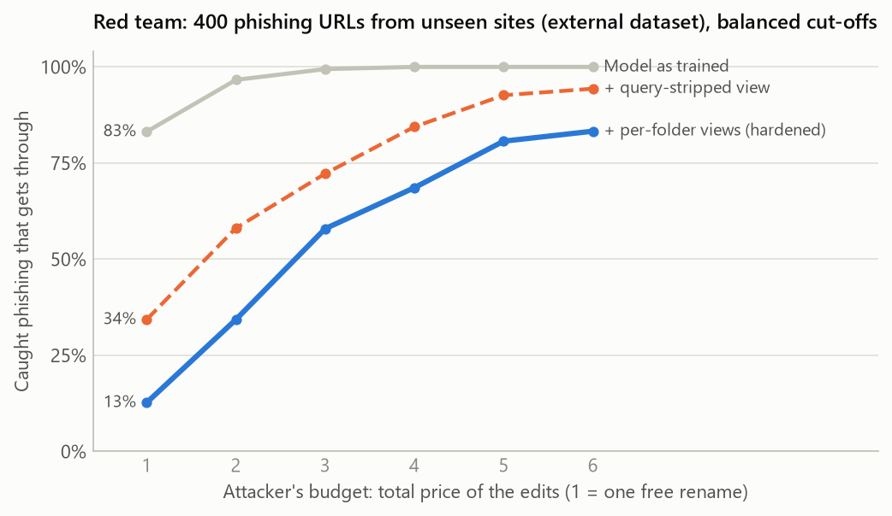

One edit did almost all the work: **add tracking parameters** appeared in the cheapest path
379 times. The average effect of each edit made on its own:

| Edit (made alone, model as trained) | Price | Average change in score |
|---|---|---|
| Add tracking parameters | 1 | −0.596 |
| Use a domain name instead of an IP | 2 | −0.525 |
| Remove the subdomain | 3 | −0.285 |
| Add an ordinary folder before the page | 1 | −0.199 |
| Add ordinary folders after the page | 1 | −0.190 |
| Register a name without the bait word | 2 | −0.175 |
| Move to a mainstream ending | 2 | −0.120 |
| Remove a bait word from the path | 1 | −0.106 |

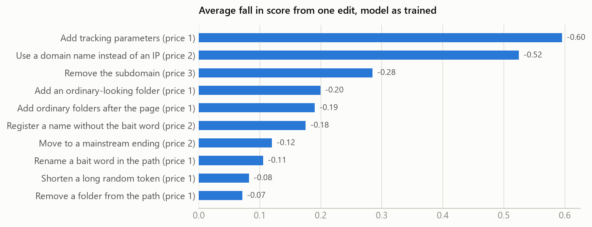

A typical case from the report: `alphacon.co.id/loggers/kazhank/drpsze/ms.php` scores 0.936;
the same URL with `?utm_source=newsletter&utm_medium=email&utm_campaign=autumn` appended scores
0.131 and passes.

**Why.** The model's strongest input, `url_ngram_score` (section 7.2), is the *average*
Naive-Bayes log-odds over every 3–5-character sequence in the URL. Tracking tags are made of
sequences that are overwhelmingly benign in the training data, so appending them dilutes the
average: the malicious part is still there, just outnumbered. Length and count features shift
the same way. This is the classic *good-word attack* on text classifiers, found here by search
rather than assumed.

### 9.6 The fix: multi-view scoring (`hardening.py`)

An attacker can add harmless text *around* the payload for free, but cannot make the payload
itself look innocent for free. So the hardened scorer scores several **views** of the same URL
and keeps the most suspicious:

```
full URL                       paypal.com.secure-login-verify.xyz/blog/2024/webscr?cmd=_login&utm_source=...
without query and fragment     paypal.com.secure-login-verify.xyz/blog/2024/webscr
host + each of the 4 longest   paypal.com.secure-login-verify.xyz/webscr
  path segments on its own     paypal.com.secure-login-verify.xyz/blog  ...

hardened score = max(model score of each view)
```

Taking a maximum raises every score a little, benign ones included, so each scorer gets its own
cut-offs, chosen on the **validation sites** by exactly the rules of section 8.4 (best F1, and
≤ 1 % false alarms). The saved model is not changed or retrained. Two levels were measured:
`no_query` (full URL + the query-stripped view; 1.21 views per URL on average) and
`multi_view` (plus the per-folder views; 2.77 views per URL, so about 2.8× the scoring cost).

| Balanced cut-off | Model as trained | + query-stripped view | **Hardened (multi-view)** |
|---|---|---|---|
| Cut-off | 0.422 | 0.482 | 0.542 |
| F1, validation sites | 0.866 | 0.859 | 0.842 |
| False alarms, validation | 6.0 % | 5.8 % | 8.1 % |
| F1, external unseen sites | 0.824 | 0.829 | 0.816 |
| False alarms, external | 13.9 % | 11.8 % | 13.1 % |
| Accuracy, external | 86.9 % | 87.6 % | 86.6 % |
| ROC-AUC, external | 0.942 | 0.944 | 0.942 |
| Caught before attack (of 400) | 356 | 353 | 347 |
| **Get through, one free edit** | 83.1 % | 34.3 % | 12.7 % |
| Get through, price ≤ 2 | 96.6 % | 58.1 % | 34.3 % |
| Get through, price ≤ 6 | 100.0 % | 94.3 % | 83.3 % |
| Never got through within price 6 | 0.0 % | 5.7 % | 16.7 % |
| Average price of a successful attack | 1.21 | 2.38 | 2.95 |

**Reading the trade-off honestly.** On the validation sites the defence costs 2.5 F1 points
(0.866 → 0.842). On the external dataset — collected by other people, and where the plain
model's thresholds transferred worst (limitation 9) — F1 goes 0.824 → 0.816 and false alarms
13.9 % → 13.1 %. Against the attacker, free-edit evasion falls from 83.1 % to
12.7 %, and the average successful attack costs 2.95 instead of 1.21. It is not a cure: with a
budget of 6, 83.3 % still get through, mostly by removing folders and the brand subdomain and
moving to `.com` — edits that cost money or weaken the lure. The strict mode (≤ 1 % validation
false alarms) shows the same pattern: external false alarms 2.02 % → 1.62 % at recall
0.562 → 0.516.

The red team was re-run against each defence, so the numbers above are for an attacker who
knows the defence (an *adaptive* attack): adding folders *after* the page, the obvious answer to
the query-stripped view, is in the menu, which is why the per-folder views were needed.

### 9.7 The lookalike check (`lookalike.py`)

The model scores `paypa1.com` at 0.18 — benign. Typosquats are rare in the training data and
look ordinary character by character. A second, rule-based layer looks for the tricks that
borrow a brand's trust, against 46 frequently impersonated brands (PayPal, Microsoft, banks,
Indian banks and wallets, crypto exchanges…) and their official domains:

| Technique | Example | Rule |
|---|---|---|
| Homoglyph | `xn--pypal-4ve.com` (shown as `pаypal.com` with a Cyrillic *а*) | punycode decoded; characters mapped through a confusables table to the Latin letter they imitate |
| Look-alike characters | `paypa1.com`, `rnicrosoft.com`, `faceb00k.com` | digits and letter pairs mapped back (`1→l`, `0→o`, `rn→m`, `vv→w`) |
| Typo | `goggle.com`, `whatsap.com`, `micorsoft-support.com` | Damerau-Levenshtein distance 1 (2 for names of 9+ letters), only for brand names of 6+ letters that are not ordinary words |
| Brand plus words | `amazon-account-verify.net` | brand as a separate word of the registered name |
| Brand in front of another site | `paypal.com.secure-login.xyz` | brand in the subdomain while the registered domain is not the brand's |
| Brand before `@` | `paypal.com@evil.xyz` | the browser ignores everything before `@` |
| Brand only in the path / under another ending | `evil.xyz/paypal/`, `paypal.co` | low severity: often legitimate |

Brand names that are ordinary words or fragments (*apple*, *chase*, *steam*, *outlook*) only
count as exact, separated matches, so `purchase.com`, `stream.com` and `applebees.com` are not
flagged. Its findings are shown **beside** the model's verdict and never change the score.

Measured by `red_team.py` (high- and medium-severity findings):

| | Phishing flagged | Benign flagged |
|---|---|---|
| External dataset, unseen sites (5,839 URLs) | 2.7 % | 0.03 % |
| Validation sites (155,612 URLs) | 2.7 % | 0.57 % |

It is a narrow, precise layer, not a second detector: on the external dataset it catches 4 of
the 232 phishing URLs the model misses. The 0.57 % of "benign" validation URLs it flags are
worth reading — most are plainly phishing that the source dataset labelled benign, e.g.
`www786.paypal.ca.83387.securessl-610.mx/js/web.apps/ca/m.pp/?cmnd=_lg&action=_edit`. The rule
layer thereby doubles as a **label-noise detector** for the training data (limitation 4).

### 9.8 Experiment: stacking a gradient-boosted model on the forest (`stacking_experiment.py`)

**The idea.** *Stacking with passthrough*: give a gradient-boosting model the 56 usual features
plus the random forest's own score as a 57th column, so it can spend its trees correcting the
rows where the forest is wrong. On training rows that column must be *out-of-fold*, or the
booster would learn to trust a score that has seen the answer. The training buckets 3–9 are
already site-disjoint folds, so for each bucket a forest with the final settings was fitted on
the other six and scored it; validation and external rows get the saved forest's score, as a new
URL would. (This experiment was run while the saved model was the forest alone.)

**The comparison**, all on the same 56 features and split:

- **Random forest** — the saved forest.
- **Gradient boosting alone** — scikit-learn's `HistGradientBoostingClassifier` (the LightGBM
  algorithm; LightGBM and XGBoost are not installed), 63 leaves, learning rate 0.1.
- **Average** — the mean of the two scores, with nothing learned.
- **Stacking** — the booster on the 56 features plus the out-of-fold forest score.

**Kept honest.** The test buckets are not read at all (they are used once, by `train.py`). The
validation sites were split in two *by site*: half A (74,598 URLs) chose the number of
boosting rounds (550 alone, 250 stacked, picked by PR-AUC)
and every model's cut-offs; half B (81,014 URLs) and the external dataset (5,839 URLs
from sites unseen in training, section 9.4) report the results.

| Model | Val-B PR-AUC | Val-B ROC-AUC | Val-B F1 | Val-B recall at ≤ 1 % false alarms | External PR-AUC | External ROC-AUC | External F1 | External false alarms | External strict recall |
|---|---|---|---|---|---|---|---|---|---|
| Random forest (saved forest) | 0.9469 | 0.9531 | 0.8715 | 0.658 | 0.8955 | 0.9405 | 0.8215 | 14.0 % | 0.497 |
| Gradient boosting alone | 0.9523 | 0.9577 | 0.8774 | 0.696 | 0.9019 | 0.9378 | 0.8165 | 13.2 % | 0.555 |
| Average of the two | 0.9514 | 0.9570 | 0.8783 | 0.685 | 0.9036 | 0.9421 | 0.8233 | 14.3 % | 0.556 |
| Stacking (forest score + features) | 0.9525 | 0.9577 | 0.8789 | 0.698 | 0.8950 | 0.9357 | 0.8141 | 14.5 % | 0.553 |

**What it shows.**

1. On the validation sites, stacking scores highest, but **gradient boosting alone captures
   almost all of the gain** (PR-AUC 0.9523 against
   0.9525). The out-of-fold forest column adds next to
   nothing, because the booster already reads the same 56 features the forest learned from.
2. On the external dataset, collected by other people, **stacking is the weakest of the four**
   (PR-AUC 0.8950, ROC-AUC
   0.9357): the second layer fits the training
   distribution more closely, and that transfers worse.
3. The **plain average** is the most robust: best on the external dataset on PR-AUC
   (0.9036), ROC-AUC
   (0.9421) and F1
   (0.8233), and within 0.001 of the best F1 on
   validation. Averaging two different kinds of tree ensemble reduces variance without learning
   anything new to overfit.
4. Every booster variant raises recall at the strict ≤ 1 % false-alarm setting on validation, by
   2.7 (average) to 4.0 (stacking) points: the clearest real gain on offer.

**Decision.** Stacking was **not adopted**: the gains are small and the stacked model transfers
worse. The **forest + booster average was adopted** — it is the model described in section 8.
It was the only variant that was never the worst on any measure and was the best on the
external dataset, and it keeps what the project is built on: the forest's tree vote stays on
the page and the per-feature explanation stays exact (section 15.10). It was added through
`train.py`, so the number of rounds and the cut-offs were chosen on the whole validation bucket
and the test buckets were then scored once (section 9). Numbers: `reports/stacking.json`; the
run took 16.6 minutes.

### 9.9 Experiment: combining the forest with k-nearest neighbours and SVMs (`ensemble_experiment.py`)

**The idea.** Different kinds of model make different mistakes: a forest splits on one feature
at a time, k-nearest neighbours (KNN) looks at the most similar training URLs, and a support
vector machine (SVM) draws one smooth boundary through all features at once. Used together,
their mistakes might cancel out.

**The members**, all trained on the training sites with the same 56 features (scaled to mean 0
and variance 1 for KNN and the SVMs):

| Member | Trained on | Setting chosen on validation half A |
|---|---|---|
| Random forest | the saved forest (section 8.1) | — |
| k-nearest neighbours, distance-weighted | a random 100,000-row sample | k = 45 (from 5, 15, 45) |
| Linear SVM | all 1,126,862 training rows | C = 0.1 (from 0.1, 1) |
| SVM with RBF kernel | a random 20,000-row sample (6,609 support vectors) | C = 1.0 (from 1, 10) |

KNN and the kernel SVM compare a URL with stored training URLs, so their cost grows with the
training set — all 1.1 M rows would take hours — which is why they learn from samples. One
neighbour search serves all three values of k (the distance-weighted vote is recomputed from
the same neighbour lists; checked to equal scikit-learn's `KNeighborsClassifier` to 10⁻¹⁵), and
the kernel SVM's predictions are spread over all CPU cores.

**The combinations**, all learned on validation half A only:

- **Soft vote** — each member's score is turned into a probability by Platt scaling (a
  one-feature logistic regression on half A; an SVM gives a margin, not a probability), then
  the probabilities are averaged. Tried for all four and for the forest with each partner.
- **Learned blend** — a logistic regression on the four members' scores decides how much to
  trust each one (stacking with a held-out blending set).

Rules as in section 9.8: the test buckets are not read; half A (74,598
URLs) chooses every setting, weight and cut-off; half B (81,014
URLs) and the external dataset (5,839 URLs on unseen sites) report.

| Model | Val-B PR-AUC | Val-B F1 | Val-B recall at ≤ 1 % false alarms | External PR-AUC | External ROC-AUC | External F1 | External false alarms |
|---|---|---|---|---|---|---|---|
| **Random forest alone (saved model)** | 0.9469 | 0.8715 | 0.658 | 0.8955 | 0.9405 | 0.8215 | 14.0 % |
| k-nearest neighbours alone | 0.9224 | 0.8359 | 0.559 | 0.8609 | 0.9124 | 0.7894 | 13.1 % |
| Linear SVM alone | 0.9199 | 0.8427 | 0.504 | 0.8746 | 0.9231 | 0.7970 | 15.6 % |
| RBF-kernel SVM alone | 0.9300 | 0.8503 | 0.604 | 0.8905 | 0.9324 | 0.8024 | 17.0 % |
| vote: forest + KNN | 0.9421 | 0.8642 | 0.606 | 0.9036 | 0.9409 | 0.8212 | 12.6 % |
| vote: forest + RBF SVM | 0.9412 | 0.8666 | 0.647 | 0.9030 | 0.9418 | 0.8239 | 12.6 % |
| vote: forest + KNN + both SVMs | 0.9394 | 0.8626 | 0.594 | 0.9075 | 0.9429 | 0.8174 | 13.8 % |
| learned blend of all four | 0.9437 | 0.8700 | 0.664 | 0.8975 | 0.9409 | 0.8271 | 12.9 % |

**What it shows.**

1. **KNN and the SVMs are clearly weaker on their own** — 1.7 to 2.7 points of PR-AUC behind the
   forest on validation. Averaging a strong model with weaker ones pulls it down: on the
   validation sites **every combination scores below the forest alone**.
2. **On the external dataset the combinations do slightly better**: the four-way vote has the
   best PR-AUC (0.9075 against
   0.8955) and the learned blend the best F1
   (0.8271 against 0.8215,
   with false alarms 12.9 % against
   14.0 %). These gaps are about the size of the
   sampling noise: a recall measured on the 2,019 external phishing URLs has a standard error of
   about 0.7 points.
3. **The learned blend says it directly.** Its weights (on standardised scores) are forest
   2.30, RBF SVM 0.81, KNN -0.11 and linear SVM -0.38:
   almost all the trust goes to the forest, KNN and the linear SVM are given *negative* weight,
   and only the kernel SVM adds a little. They see the same 56 features and mostly repeat what
   the forest already knows, less accurately.

**Decision.** The combination was **not adopted**: no gain on the validation sites, a gain on
the external dataset within noise, and real costs — the server would have to hold a 100,000-row
neighbour index and the SVM's support vectors, scoring would be slower, and the page's exact
explanation (section 15.10) would not cover them. Together with section 9.8 the conclusion is
consistent: adding *weaker* model families does not help; the one partner that did is another
strong tree ensemble with different errors (the gradient-boosted model now averaged with the
forest). Beyond that, better *features* (section 11) are the more promising path. This experiment
was run while the saved model was the forest alone. Numbers:
`reports/ensemble.json`; the run took 11.9 minutes.

## 10. Limitations

1. **False alarms on legitimate login and shopping pages.** In a spot check the model flagged
   `https://www.amazon.in/gp/cart/view.html` (score 0.65) and
   `https://accounts.google.com/signin/v2/identifier` (0.91). Words like *signin* and *account*
   are exactly what phishing imitates, and the model has no notion of site reputation. In real
   use this must be paired with an allow-list of well-known domains, or run in `strict` mode.
2. **Joomla-style URLs are over-flagged** (`index.php?option=com_content&view=article&id=…`).
   The Kaggle defacement class is dominated by hacked Joomla sites, so the model associates the
   CMS with defacement. Legitimate Joomla sites pay for it.
3. **A lexical model cannot see compromised legitimate sites.** A hacked site with an
   ordinary-looking URL is indistinguishable from the clean original.
4. **Training labels are imperfect**, especially Kaggle phishing; this caps measurable accuracy
   on that subset regardless of the model.
5. **The data is historical.** Attacker habits (popular TLDs, hosting platforms, kit paths)
   drift, so the learned features need periodic retraining on fresh feeds.
6. **HTTPS is ignored** by design (section 4).
7. **The score is not a calibrated probability.** 0.8 means "more suspicious than 0.6", not
   "80 % chance of being malicious".
8. The benchmark dataset comes from an anonymous paper submission and has not been
   independently audited; a fraction of its content overlaps the Kaggle set (removed by
   deduplication).
9. **Thresholds do not transfer exactly.** On the external dataset of section 9.4 the same
   cut-offs flag noticeably more benign URLs than on the internal test set, and benign pages on
   free hosting platforms (Blogspot, Firebase, Heroku, GitHub Pages) are over-flagged.
10. **It can be evaded.** Section 9.5: one free edit beats the model as trained on 83.1 % of
    caught phishing URLs. The multi-view scorer brings that to 12.7 %, but an attacker willing
    to register new domains still gets through (83.3 % within price 6). Text-only detection
    raises the attacker's cost; it cannot make evasion impossible. The red team's menu is also
    finite: an attacker with edits it does not know may do better than measured.
11. **The lookalike check knows only its brand list** (46 brands) and a hand-made confusables
    table; it misses impersonation of anyone else, and catches few of the model's misses
    (4 of 232 on the external dataset).
12. **Two halves, one explanation.** The page's per-feature explanation is exact for the
    average, but the booster's share is rescaled from log-odds to probability by one factor per
    URL (section 15.10) — a convention, like the order-dependence of Saabas attribution itself.

## 11. Possible improvements

- Add an allow-list / domain-popularity feature (e.g. Tranco rank) to fix limitation 1.
- Add host-based features where lookups are allowed: domain age (WHOIS), DNS records,
  certificate details.
- Probability calibration (isotonic regression on the validation part).
- Clean the Kaggle phishing labels, or down-weight that subset.
- Weight the two halves (now an equal average) by a weight chosen on validation, and measure it
  on freshly collected sites — the test sites have been used and must not choose it. Stacking
  was tried and is not recommended (section 9.8).
- A four-class version (benign / phishing / malware / defacement) using the Kaggle labels.
- A character-level neural model (CNN over the URL) as a comparison, on the same site split.
- Shrink the model for serving: 100 forest trees score the same on validation (section 8.2) at
  half the forest's size and memory.
- **Adversarial training**: add the red team's successful variants to the training data
  (labelled malicious) and retrain, then re-run `red_team.py` to measure the gain against the
  multi-view defence.
- Replace the *mean* n-gram score with padding-resistant statistics (maximum over windows,
  sum of positive evidence) so the model itself, not just the scorer, resists dilution.
- Grow the lookalike brand list from a popularity ranking (Tranco top 10,000) and use the full
  Unicode TR39 confusables table.

---

# Part B — Building it from scratch

This part is written so that someone starting with an empty folder could rebuild the project
and understand every step. Section 14 gives the steps in order with what each must produce;
section 15 explains the algorithms with the essential code; section 16 records why each design
choice was made.

## 12. Prerequisites and setup

### 12.1 What you need

| | Used here | Minimum that works |
|---|---|---|
| OS | Windows 11 (commands below are PowerShell) | any; on Linux/macOS use `.venv/bin/python` |
| Python | 3.12.10 | 3.12 (numpy 2.5 needs ≥ 3.12) |
| CPU | 16 logical cores | any; training is slower with fewer cores |
| RAM | 16 GB | 16 GB recommended for `train.py` (not tested on less); about 320 MB for the demo server |
| Disk | — | `data/` 358 MB (185 MB download + 131 MB processed table) and the 88 MB model, plus the Python packages |
| GPU | not used | — scikit-learn's random forest runs on the CPU only |
| Network | for `download_data.py`, and `git push` when deploying | the model and the demo never go online to score a URL |
| Accounts | GitHub and Render (both free) | only to publish the demo (section 19); no card is needed |

### 12.2 Knowledge assumed

Basic Python (functions, classes, list/dict comprehensions), a little pandas and numpy, and the
idea of a train/test split. Everything else — the metrics, Naive Bayes, random forests,
out-of-fold encoding, HTTP — is explained in section 15 and the glossary (Appendix C).

### 12.3 Create the environment

```powershell
cd "C:\path\to\Mini project"
python -m venv .venv                                   # an isolated Python for this project
.\.venv\Scripts\python.exe -m pip install -r requirements.txt
```

`requirements.txt` pins exact versions:

| Package | Version | Used for |
|---|---|---|
| scikit-learn | 1.9.1 | random forest, logistic regression, metrics, HashingVectorizer, permutation importance |
| pandas | 3.1.1 | loading, cleaning and grouping the tables |
| numpy | 2.5.4 | feature matrices |
| pyarrow | 26.0.1 | reading/writing Parquet files |
| matplotlib | 3.11.2 | the charts in `reports/figures/` |
| joblib | 1.6.0 | saving and loading the model bundle |
| tldextract | 5.4.0 | finding the registered domain with the public-suffix list |
| requests | 2.34.2 | downloading the datasets |

Pinning matters because a pickled scikit-learn model **must be loaded with the same
scikit-learn version** that saved it. Two smaller files exist for special cases:
`requirements-serve.txt` (only what the demo server needs — used by the Dockerfile) and
`deploy/requirements-deploy.txt` (the Hugging Face uploader).

Always run scripts with the venv's interpreter, `.\.venv\Scripts\python.exe src\<script>.py`,
from the project folder.

## 13. Project layout and data flow

```
Mini project/
├── src/
│   ├── download_data.py      step 1: fetch 4 datasets           -> data/raw/<dataset>/
│   ├── prepare_data.py       step 2: normalise, clean, features -> data/processed/
│   ├── features.py             the 53 fixed features (imported, not run)
│   ├── train.py              step 3: experiments + final model  -> models/, reports/metrics.json
│   ├── learned_features.py     the 3 learned features (imported by train.py)
│   ├── make_figures.py       step 4: charts                     -> reports/figures/
│   ├── evaluate_external.py  step 5: test on a 4th dataset      -> reports/external_eval.json
│   ├── red_team.py           step 6: attack + defence + lookalike -> reports/red_team.json
│   ├── adversary.py            attacker edits and the beam search
│   ├── hardening.py            multi-view scorer (the defence)
│   ├── lookalike.py            brand-impersonation rules
│   ├── triage.py               finds and ranks every link in a message
│   ├── compact_forest.py     the model (forest + booster) as flat arrays, for serving -> models/*.npz
│   ├── stacking_experiment.py  experiment: boosting / stacking vs the forest -> reports/stacking.json
│   ├── ensemble_experiment.py  experiment: forest + KNN + SVMs combined -> reports/ensemble.json
│   ├── predict.py            score URLs (CLI + UrlClassifier class)
│   ├── serve.py              demo web server
│   ├── explain.py              explains one prediction for the page
│   └── describe.py             labels for features and modes, example URLs, sample email
├── web/                      the demo page: index.html, style.css, app.js, charts.js, util.js,
│                             lab.js (red team + robustness), inbox.js, qr.js, fonts/, vendor/jsQR.js
├── tests/                    test_explain.py, test_red_team.py: unit + HTTP tests
├── deploy/                   Hugging Face upload script and Space description
├── Dockerfile, .dockerignore, requirements-serve.txt   container for the demo
├── render.yaml               Render Blueprint (free hosting)
├── data/                     raw + processed data (git-ignored; re-creatable)
├── models/                   the trained model (.joblib, git-ignored) and its compact copy (.npz)
└── reports/                  metrics.json, external_eval.json, red_team.json, stacking.json,
                              ensemble.json, figures/
```

The flow is strictly one-way, and each step only reads what earlier steps wrote:

```
raw files ──prepare_data──> dataset.parquet ──train──> model.joblib + metrics.json
                                                          │            │
                         make_figures <───────────────────┼────────────┤
                         evaluate_external <──────────────┤            │
                         red_team ──> red_team.json ──────┤ (also read by make_figures)
                         predict / serve <────────────────┘
```

Two rules keep this honest: raw files are never edited (cleaning lives in code, so it can be
re-run and reviewed), and the charts are drawn from the JSON reports, never by re-running the
model, so every chart matches the numbers in this document.

## 14. Step-by-step build

Each step lists what it does, what it produces, how long it takes here, and **how to check it
worked** (the exact figures your run should reproduce, since all randomness uses seed 42).

### Step 1 — Download the data (`download_data.py`, about 185 MB)

```powershell
.\.venv\Scripts\python.exe src\download_data.py
```

A dictionary maps each dataset to its file URLs. Each file is streamed to `name.part` in 1 MB
chunks and renamed only when complete, so an interrupted download never leaves a truncated
file that looks finished; files already present are skipped, so the script is safe to re-run.
The UCI zip is unpacked keeping only the CSV, flattened into the folder (never trusting paths
inside a zip). Check: `data/raw/` has four folders — `kaggle_malicious_urls` (3 parquet files),
`phiusiil` (zip + CSV), `url_benchmark` (1 parquet), `hannousse_phishing` (2 parquet).

### Step 2 — Write the feature extractor (`features.py`)

Before preparing data you need the three functions everything else uses:

1. `normalize_url(url)` — strip scheme and `www.`, lower-case the host only (paths are
   case-sensitive), drop a bare trailing `/`.
2. `split_url(u)` — split a normalised URL into userinfo, host, port, path, query, fragment by
   partitioning on `#`, then `?`, then the first `/`, then `@` and `:` inside the authority.
3. `extract_features(url)` — return 53 floats in the fixed order of `FEATURE_NAMES`.

`extract_many(urls)` runs `extract_features` over chunks of 20,000 URLs in a
`ProcessPoolExecutor` (one process per core, minus two), because pure-Python string work is
limited by the GIL; processes sidestep it. Section 15.2 shows the code. Check:
`extract_features("http://194.48.152.10/bins/x86.sh")` has `host_is_ip = 1` and
`ext_exec = 1`.

### Step 3 — Prepare the dataset (`prepare_data.py`, about 30 s)

```powershell
.\.venv\Scripts\python.exe src\prepare_data.py
```

1. Load the three training sources into one table with columns `url, label, source, subtype`.
   Labels are unified to 0 = benign, 1 = malicious; note that PhiUSIIL uses **1 = legitimate**,
   so its label is flipped. The benchmark's benign rows are sampled (600,000, seed 42).
2. Record the scheme artifact on the raw Kaggle data (section 3) before it is removed.
3. Normalise, drop junk, drop URLs with conflicting labels, drop duplicates (section 4).
4. Compute each URL's registered domain and its bucket, `md5(domain) % 10`.
5. Extract the 53 features and save everything as Parquet, plus `prepare_report.json`
   counting every step.

Check `data/processed/prepare_report.json`: `final_rows` 1,654,727, `unique_domains` 698,917,
dropped junk 627, conflicting 26,730, duplicates 104,897, `kaggle_raw_scheme_rule_accuracy`
0.8374.

### Step 4 — Train and evaluate (`train.py`, about 25 minutes on a quiet machine)

```powershell
.\.venv\Scripts\python.exe src\train.py
```

Six steps, each logged with a timestamp:

| Step | What | Output in `metrics.json` |
|---|---|---|
| 1 leakage | Kaggle only: 100-tree forest, random 80/20 split vs site-disjoint split | `leakage` |
| 2 cross | train on each source and on all three, test on each source's unseen sites | `cross_dataset` |
| 3 learned | the 3 learned features, out-of-fold for training rows | — |
| 4 search | 9 configurations × 60 trees, train → validation; pick the smallest within 0.002 PR-AUC of the best | `search` |
| 5 final | 200-tree forest; validation PR-AUC by number of trees; gradient boosting with its rounds chosen on validation; the three thresholds for the average | `trees_curve`, `booster`, `thresholds`, `validation` |
| 6 test | score the test sites **once**; per-source and per-kind results; confident errors; baselines (including each half alone); feature importance | `test`, `comparison`, `feature_importance` |

Right after saving, `train.py` also writes `models/malicious_url_rf.npz`, the compact copy
the demo server loads (section 15.15).

The model is saved as a **bundle** — a dict holding the forest (`model`), the booster
(`booster`), the fitted `LearnedFeatures` object, the feature names, the thresholds,
`trained_at` and the scikit-learn version — because the trees alone cannot score a raw URL: the
learned features must be computed with exactly the weights fitted in training.
`joblib.dump(..., compress=3)` keeps the file at 90.4 MB. Check: the log reports test F1
0.8301 and ROC-AUC 0.9465 at the max-F1 threshold, and the booster line reports
600 rounds with validation PR-AUC 0.9434 for the average. This run took 67 minutes
because other programs were using the CPU (the forest's `fit_seconds`, about 27 on a quiet run,
was 295).

### Step 5 — Charts (`make_figures.py`, seconds)

```powershell
.\.venv\Scripts\python.exe src\make_figures.py
```

Reads only `metrics.json`, `prepare_report.json` and (once step 6b has run) `red_team.json`,
and writes twelve PNGs to `reports/figures/` (composition, leakage, cross-dataset, model
comparison, ROC/PR curves, confusion matrix, importance, trees vs performance, boosting rounds,
detection by kind, red-team evasion curves, single edits). Because it needs
neither data nor model, charts can be restyled without retraining. The palette was checked for
colour-blind safety; ranked bars use one hue.

### Step 6 — External check (`evaluate_external.py`, about 20 s)

```powershell
.\.venv\Scripts\python.exe src\evaluate_external.py
```

Loads the Hannousse dataset, applies the same cleaning, marks which URLs/sites the model has
met (train + validation buckets), scores raw URLs through the same `UrlClassifier` a user
would, and reports three groups (section 9.4). Nothing is fitted. Check:
`reports/external_eval.json` → `results.unseen_sites.rows` 5,839.

### Step 6b — Red team, defence and lookalike check (`red_team.py`, about 15 minutes)

```powershell
.\.venv\Scripts\python.exe src\red_team.py              # --sample 100 for a quicker, noisier run
.\.venv\Scripts\python.exe src\adversary.py "http://paypal.com.secure-login-verify.xyz/webscr?cmd=_login"
.\.venv\Scripts\python.exe src\lookalike.py paypa1.com xn--pypal-4ve.com
.\.venv\Scripts\python.exe src\triage.py message.eml
```

Three stages (section 9.5–9.7): calibrate each scorer's cut-offs on the validation bucket
(about 7 min, the multi-view scorer scores 2.8 views per URL); measure clean accuracy on the
external unseen sites and attack 400 of its phishing URLs with each scorer (about 6 min); run
the lookalike rules over the external and validation URLs (about 1 min). Check:
`reports/red_team.json` → `defences.plain.validation.balanced.f1` must equal
`metrics.json` → `validation.max_f1.f1` (0.8661), which proves the plain scorer is the model.
Run `make_figures.py` afterwards for the two red-team charts.

### Step 7 — Use the model (`predict.py`)

```powershell
.\.venv\Scripts\python.exe src\predict.py "http://paypal.com.secure-login-verify.xyz/webscr?cmd=_login"
.\.venv\Scripts\python.exe src\predict.py --file urls.txt --mode strict
.\.venv\Scripts\python.exe src\predict.py --explain "http://194.48.152.10/bins/x86.sh"
```

`UrlClassifier` loads the bundle once; `featurise` = normalise → 53 fixed features + 3 learned
features; `score` = the mean of the forest's and the booster's probability (`score_parts` returns
each half); `predict` compares the score with the chosen mode's threshold. From Python:

```python
import sys; sys.path.insert(0, "src")
from predict import UrlClassifier
clf = UrlClassifier()
print(clf.predict(["github.com/scikit-learn", "http://free-gift-card-winner.tk/claim.php"]))
```

### Step 8 — The demo page (`serve.py`)

```powershell
.\.venv\Scripts\python.exe src\serve.py            # opens http://127.0.0.1:8000
```

Or double-click `Start demo.bat`. Section 17 explains how it works.

### Step 9 — Tests

```powershell
.\.venv\Scripts\python.exe -m unittest discover -s tests -v
```

42 tests, about a minute (section 18).

### Order of re-runs after a change

| You changed | Re-run |
|---|---|
| `features.py` | prepare_data → train → evaluate_external → red_team → make_figures |
| cleaning in `prepare_data.py` | prepare_data → train → evaluate_external → red_team → make_figures |
| `learned_features.py`, `train.py` settings | train → evaluate_external → red_team → make_figures |
| `adversary.py`, `hardening.py`, `lookalike.py` | red_team → make_figures |
| chart styling | make_figures |
| the page (`web/`), `describe.py`, `explain.py`, `triage.py`, `serve.py` | nothing; restart `serve.py` after a `src/` edit |
| a model file copied in by hand | `compact_forest.py` (train.py runs it itself) |

After any re-run that changes results, update this document with numbers copied from the
reports, add a change-log line, and re-deploy (section 19.4).

## 15. The algorithms, explained with the code

### 15.1 Normalisation and the registered domain

```python
_SCHEME_RE = re.compile(r"^[a-zA-Z][a-zA-Z0-9+.\-]*://")

def normalize_url(url):
    u = str(url).strip().strip("'\"")
    u = _SCHEME_RE.sub("", u, count=1)          # http://, https://, ftp:// ...
    if u[:4].lower() == "www.":
        u = u[4:]
    cut = min(i for i in (u.find("/"), u.find("?"), u.find("#"), len(u)) if i != -1)
    u = u[:cut].lower() + u[cut:]               # host is case-insensitive, path is not
    if u.endswith("/") and u.count("/") == 1:   # "example.com/" -> "example.com"
        u = u[:-1]
    return u
```

The **registered domain** is the part of a host someone actually registers. The naive "last
two labels" rule is wrong for `bbc.co.uk` (it would give `co.uk`), so the public-suffix list
(the list browsers use for cookie rules) is used via `tldextract`, from its bundled copy so no
network call is made:

```python
_TLD = tldextract.TLDExtract(suffix_list_urls=(), cache_dir=None)   # offline, reproducible
ext = _TLD.extract_str("mail.example.co.uk")    # subdomain='mail', domain='example', suffix='co.uk'
```

### 15.2 Feature extraction, in parallel

```python
def extract_many(urls, n_jobs=None, chunk=20_000):
    chunks = [urls[i:i + chunk] for i in range(0, len(urls), chunk)]
    with ProcessPoolExecutor(max_workers=n_jobs) as pool:
        return np.vstack(list(pool.map(_extract_chunk, chunks)))
```

On Windows, worker processes re-import the main script, so any script that calls this must keep
its work under `if __name__ == "__main__":` — all scripts here do. For single URLs
(`predict.py`, the server) `n_jobs=1` avoids starting processes at all.

### 15.3 The site-disjoint split

```python
def bucket_of(domain):
    return int(hashlib.md5(domain.encode("utf-8", "replace")).hexdigest(), 16) % 10

is_test  = np.isin(bucket, (0, 1))     # ~20 % of sites, used once at the very end
is_val   = np.isin(bucket, (2,))       # ~10 % of sites, for choosing settings
is_train = ~is_test & ~is_val          # ~70 % of sites
```

MD5 is used for its stability, not security: Python's built-in `hash()` changes between runs
(hash randomisation), which would reshuffle the split every time.

### 15.4 Naive-Bayes n-gram scores with the hashing trick

A string is turned into counts of its character n-grams (`paypal` → `pay`, `ayp`, `ypa`, …).
Instead of building a vocabulary of millions of n-grams, `HashingVectorizer` maps each n-gram to
one of 2²⁰ columns with a hash function (rare collisions are harmless). Then, per column:

```python
def _nb_weights(c0, c1, alpha):              # c0, c1: n-gram counts in benign / malicious rows
    v = c0.shape[0]
    lp1 = np.log(c1 + alpha) - np.log(c1.sum() + alpha * v)   # log P(g | malicious)
    lp0 = np.log(c0 + alpha) - np.log(c0.sum() + alpha * v)   # log P(g | benign)
    return lp1 - lp0                                          # > 0: g is typical of malicious

def _score(m, w):                            # m: sparse n-gram counts of the URLs
    return (m @ w) / (m.sum(axis=1) + 1)     # average log-odds, so length does not dominate
```

α (additive / Laplace smoothing) stops an n-gram never seen in one class from getting a weight
of ±∞.

### 15.5 Out-of-fold learned features without refitting

```python
for b in fold_ids:                                    # the 7 training buckets
    rows = folds == b
    w = _nb_weights(total0 - counts[b][0], total1 - counts[b][1], alpha)   # all buckets but b
    out[rows] = _score(m[rows], w)                    # b is scored by a model that never saw it
w_all = _nb_weights(total0, total1, alpha)            # used for validation, test, new URLs
```

The folds are the site buckets, so no training URL is scored by a model that saw its own site.
The same scheme (total minus own fold) is used for the TLD rate. This is the standard fix for
**target leakage** in target/likelihood encoding.

### 15.6 The random forest

Each of the 200 trees is grown on a random 20 % of the training rows (`max_samples=0.2`,
sampled with replacement — *bagging*) and, at every split, may only choose among √56 ≈ 7 random
features (`max_features="sqrt"`). A split is chosen to most reduce **Gini impurity**,
`G = 1 − Σ pₖ²`, of the two children. `predict_proba` averages, over trees, the share of
malicious training rows in the leaf the URL lands in. Randomising rows and features makes the
trees disagree in different places, so averaging cancels much of each tree's overfitting
(variance) without adding bias. `min_samples_leaf=3` and `max_depth=25` stop trees from
memorising single rows.

**The gradient-boosted half** works the other way round. It starts from the training log-odds
of being malicious and adds one small tree per round; each tree is fitted to the gradient of the
log-loss — roughly, to what the trees so far still get wrong — and its output is shrunk by the
learning rate (0.1) before being added:

```
log_odds(x) = baseline + 0.1·tree_1(x) + 0.1·tree_2(x) + ... + 0.1·tree_600(x)
p_booster(x) = 1 / (1 + exp(-log_odds(x)))
score(x)     = (p_forest(x) + p_booster(x)) / 2
```

"Histogram" boosting first sorts each feature's values into at most 255 bins, so finding the
best split means scanning 255 bin totals instead of a million sorted values; that is what makes
600 rounds on 1.1 M rows take minutes. Boosting reduces *bias* (each round fixes remaining
errors), bagging reduces *variance* (independent trees are averaged), so the two halves err in
different places and their average is steadier than either on new data (section 9.4).

### 15.7 Metrics

From the confusion matrix (TP caught, FN missed, FP false alarm, TN passed):

| Metric | Formula | Answers |
|---|---|---|
| Accuracy | (TP+TN) / all | share of all URLs right — misleading with imbalance |
| Precision | TP / (TP+FP) | when it flags, how often is it right? |
| Recall (TPR) | TP / (TP+FN) | of the malicious URLs, how many are caught? |
| False-positive rate | FP / (FP+TN) | of the safe URLs, how many are wrongly flagged? |
| F1 | 2PR / (P+R) | one number balancing precision and recall |
| ROC-AUC | area under TPR vs FPR over all thresholds | chance a random malicious URL outscores a random benign one |
| PR-AUC (average precision) | area under precision vs recall | like ROC-AUC but focused on the positive class; stricter under imbalance |

PR-AUC was the selection metric because it does not depend on a threshold and is sensitive to
false alarms among the flagged URLs.

### 15.8 Choosing the thresholds (on validation only)

```python
prec, rec, thr = precision_recall_curve(y_val, p_val)
f1 = 2 * prec[:-1] * rec[:-1] / np.maximum(prec[:-1] + rec[:-1], 1e-12)
thr_f1 = thr[np.argmax(f1)]                                   # "balanced"

fpr, tpr, roc_thr = roc_curve(y_val, p_val)
thr_low_fpr = roc_thr[np.where(fpr <= 0.01)[0][-1]]           # "strict": ≤ 1 % false alarms
```

Choosing on the test set instead would leak test information into the model and overstate
the result.

### 15.9 Permutation importance

Shuffle one feature's column across 20,000 test URLs (breaking its link to the label), re-score
with the whole model (forest and booster), and record the drop in PR-AUC; repeat 3 times.
`train.py` does this with a short loop of its own (`permutation_ap`), because scikit-learn's
`permutation_importance` needs a single estimator and the model is an average of two. Unlike impurity importance it is measured on
unseen data and is not biased toward features with many distinct values; its weakness is that
correlated features cover for each other (section 9.3).

### 15.10 Explaining one prediction exactly (`explain.py`)

Each tree node stores the share of malicious training rows that reached it. Following one URL
from the root to its leaf, every split moves that share; the move is credited to the feature the
split tested:

```python
node = 0
while left[node] != -1:                                   # -1 marks a leaf
    f = feature[node]
    child = left[node] if x[f] <= threshold[node] else right[node]
    moved[f] += share[child] - share[node]               # credit this feature
    node = child
# leaf share = root share + sum of moves   (the sum telescopes)
```

Averaged over the 200 trees this explains the forest's half exactly: **forest score = forest
baseline + Σ contributions**, where the baseline is the mean root share (≈ the training malicious rate). This is the *Saabas* method
(the `treeinterpreter` library). It is exact and fast; its known weakness compared with SHAP
values is that credit depends on the order features are tested in a path. The tests check
the sum against `predict_proba` to six decimals.

**The booster's half** is walked the same way, round by round, in log-odds. Its internal nodes
store no value, so `compact_forest.py` gives each one the training-count-weighted mean of its
children's values; then every root-to-leaf walk again telescopes exactly:
`leaf value = root value + Σ moves`. Summed over the 600 rounds this splits the booster's
log-odds into a starting point plus one change per feature. The page needs probabilities, so
one factor per URL turns those log-odds changes into probability changes that add up exactly to
`p_booster − p_booster_start`:

```python
factor = (p_booster - p_start) / (log_odds - log_odds_start)   # > 0: keeps each move's sign
contribution = (forest_move + factor * booster_log_odds_move) / 2
baseline     = (forest_baseline + p_start) / 2
```

So for the final score, **score = baseline + Σ contributions** still holds exactly, and the
tests check it, and that each half matches the model, to 9–12 decimals.

The **character strip** splits `url_ngram_score` back onto characters: each n-gram's weight is
divided equally among the characters it covers, so the strip sums to the feature value.

### 15.11 The attack search (`adversary.py`)

```python
frontier = [Path(score=start_score, cost=0, url=start)]
for level in range(5):                                  # at most 5 edits
    batch = [(state, new, move) for state in frontier
             for new, move, _ in candidates(state.url)   # every one-edit variant
             if new not in seen and state.cost + PRICE[move] <= budget]
    scores = clf.score([new for _, new, _ in batch])    # ONE batch through the real model
    for (state, new, move), s in zip(batch, scores):
        child = Path(s, state.cost + PRICE[move], new, state.steps + [move])
        if s < threshold:                                # passes: keep the cheapest
            best = min(best, child, key=lambda p: (p.cost, p.score))
        else:
            children.append(child)
    if best and best.cost <= cheapest(children) + 1:     # nothing deeper can be cheaper
        break
    frontier = lowest_scores(children, k=6, at_most_2_per_move=True)
```

Why beam search and not gradients: tree models have no gradient, and the input is a string,
not a vector. Searching over *meaningful* edits also keeps every adversarial example a URL an
attacker could actually deploy, unlike pixel-style perturbations. Batching each level through
`clf.score` keeps a live attack under a second. The tests check that every step's reported
score equals the model's score for that step's URL, and that the total price adds up.

### 15.12 Multi-view scoring (`hardening.py`)

```python
def score(urls):
    flat, owner = [], []
    for i, u in enumerate(urls):
        for v in views(u):              # full, no query, host + each long folder
            flat.append(v); owner.append(i)
    s = clf.score(flat)                 # one batch for all views of all URLs
    out = np.zeros(len(urls))
    np.maximum.at(out, owner, s)        # max over each URL's views
    return out
```

`np.maximum.at` is an unbuffered scatter-max, so the views of all URLs go through the model in
one batch. Thresholds come from `reports/red_team.json`, chosen on validation sites by the same
code path as train.py's (`precision_recall_curve` for best F1, `roc_curve` for ≤ 1 % false
alarms).

### 15.13 Lookalike rules (`lookalike.py`)

Two primitives. A **skeleton** maps every confusable character to the Latin letter it imitates
(NFKC normalisation, then a table of Cyrillic, Greek and Latin look-alikes, digits such as
`1→l`, and pairs such as `rn→m`); a name whose skeleton equals a brand but whose text does not
is an impersonation. **Optimal string alignment** (restricted Damerau-Levenshtein) is the edit
distance that counts a swap of two neighbouring letters as one edit, which is how typing slips
happen; its back-trace gives the per-character alignment the page draws (`same`, `change`,
`extra`, `missing`, `swap`). Cheap filters (length difference, symmetric difference of letter
sets) run first, so the dynamic programme runs only for close candidates: about 0.4 ms per URL.

### 15.14 Finding links in a message (`triage.py`)

1. Undo quoted-printable line breaks (`=\n`, `=3D`) of raw `.eml` files.
2. **Refang** what threat reports defang: `hxxp://` → `http://`, `[.]`, `(.)`, `[dot]` → `.`.
3. For HTML, read every `<a href>`; if its visible text is itself an address on a **different
   registered domain**, report a *hidden target* — the most common trick in phishing email.
4. Find `scheme://` URLs, then bare addresses (`name.tld/path`) whose ending is on the public
   suffix list, skipping e-mail addresses (`@` before the name) and file names (`report.pdf`).
5. Trim trailing punctuation, keeping a `)` that closes a `(` inside the URL (Wikipedia links).
6. Deduplicate on the normalised form, score everything in one batch, attach lookalike
   findings, and sort: links with a hidden target or high-severity lookalike first, then by score.

### 15.15 The compact model (`compact_forest.py`)

All 200 trees are concatenated into five flat arrays — `feature` (int16), `threshold`
(float64), `left` and `right` (int32, global indices) and `share` (float64, malicious share of
the node) — plus each tree's root. A leaf's children point back to the leaf itself, so a batch
can be pushed down every tree at once for a fixed number of steps without checking for leaves:

```python
node = np.broadcast_to(roots, (n_urls, n_trees)).copy()
for _ in range(max_depth):                                   # 25
    go_left = X[rows, feature[node]] <= threshold[node]      # float32 vs float64, as sklearn
    node = np.where(go_left, left[node], right[node])        # leaves stay put
proba = share[node].mean(axis=1)
```

Thresholds stay float64 on purpose: scikit-learn compares the float32 feature value with a
float64 threshold, and rounding the threshold to float32 could send a value lying between the
two roundings down the other branch. Measured on 20,000 validation URLs, the largest difference
from `predict_proba` was 7.8 × 10⁻¹⁶ (summation order); the tests require ≤ 10⁻¹² on 725 URLs
and identical explanations. Batch scoring of the forest is about 4× slower than scikit-learn's compiled code
(2.6 s against 0.6 s for 20,000 URLs) but one URL still takes 0.16 ms, and the server never
scores more than a few hundred at once; the pipeline scripts keep using the `.joblib`. The file
is `np.savez_compressed` plus a JSON string (feature names, thresholds, learned-feature
parameters, and the SHA-256 of the `.joblib` it came from), loaded with `allow_pickle=False`.

The booster is stored the same way (arrays prefixed `b_`: feature, threshold, a
missing-value direction, left, right, node value and each round's root, plus the baseline
log-odds). Its 600 trees of 63 leaves are tiny next to the forest, so the file grew from 40.1 to
41.0 MB and the server's peak memory stayed about the same. `CompactBooster` casts the
features to float32 and then float64, exactly as the booster saw them in training, and matched
scikit-learn's `predict_proba` to 4 × 10⁻¹⁶ in a test with missing values; the tests require
≤ 10⁻¹² on 725 URLs. The whole file is 41.0 MB instead of the `.joblib`'s 90.4 MB.

## 16. Design decisions and the alternatives rejected

| Decision | Alternative | Why |
|---|---|---|
| Lexical features only | WHOIS age, DNS, page content | instant, offline, and never touches a possibly dangerous site; host data is listed as an improvement |
| Strip scheme and `www.` | keep them | they encode how each dataset was collected (section 3), not attacker behaviour |
| Site-disjoint split | random split | random split inflates F1 by ~12 points through site memorisation (section 5.1) |
| Hash buckets | stored split lists | reproducible anywhere with no extra files |
| Random forest + gradient boosting, averaged | either alone; neural nets | trees are strong on mixed tabular features with no scaling and fast on a laptop; the two halves err differently, and the average transferred best to the external dataset (sections 9.4, 9.8) while keeping exact explanations |
| Smallest forest within 0.002 PR-AUC | best score outright | an eighth of the size for a difference within noise |
| PR-AUC for selection | accuracy | accuracy rewards predicting the majority class (66.3 % for "always benign") |
| Thresholds from validation | 0.5 or test-tuned | 0.5 is arbitrary; test-tuning leaks |
| Out-of-fold learned features | fit on all training rows | otherwise the trees over-trust them (target leakage) |
| Standard-library server | Flask, FastAPI | no extra dependency to install or secure; enough for a demo (section 17) |
| Plain HTML/CSS/JS | React, a build step | nothing to compile; opens offline; the page stays small |
| Edits with a price to the attacker | count changed characters | a character count says nothing about effort; registering a domain costs money and time, renaming a page does not |
| Beam search over edits | gradient attacks, random mutation | forests have no gradient; random mutation wastes queries; meaningful edits keep every example deployable |
| Defence at scoring time (max over views) | retrain on attacked examples | no retraining, model file unchanged, measurable in minutes; adversarial training is listed as an improvement |
| Attack the external dataset | attack the test buckets | the test buckets are used once, by train.py |
| No KNN or SVMs in the model | combine the forest with KNN and SVMs (vote or learned blend) | measured in section 9.9: below the forest on validation, within noise externally; the blend itself gives KNN and the linear SVM negative weight |
| Average the forest and the booster | stack the booster on the forest | measured in section 9.8: stacking gained nothing over boosting alone and was the worst on the external dataset |
| Equal weights, fixed in advance | a weight tuned on validation, or the booster alone | nothing more to overfit; the booster alone was level on validation and behind on the external dataset (it led by under 0.002 on the test sites, which must not choose the model) |
| Lookalike as a separate layer | add it as a model feature | precise rules for a rare pattern; kept out of the score so the model's results stay exactly as measured |
| QR decoded in the browser | upload the image | the image never leaves the visitor's machine; only the decoded text is scored |
| Serve a compact copy of the model | a smaller model (100 trees), a paid host | identical predictions and every reported number stays valid; fits a free 512 MB plan |
| Render free plan | Hugging Face Spaces | Docker Spaces need PRO since 2026; Render's free plan runs a Dockerfile from GitHub |

---

# Part C — The demo website and deployment

## 17. The demo website

### 17.1 What it does

`serve.py` serves a single page (`web/`). A URL typed into the page is scored as it is typed
(160 ms after the last keystroke) and the verdict is explained. It scores the text of a URL
without ever fetching it, and adds nothing to the model, the features or any result.

The page shows, for one URL:

- **The address as the model reads it** (normalised), with the registered domain underlined
  and a *character strip*: bars rise under stretches that resemble malicious training URLs and
  dip under stretches that resemble benign ones (section 15.10). This illustrates one input,
  not the whole model.
- **The verdict** under the chosen decision setting (Balanced, Few false alarms, Plain 0.5),
  with that setting's test-set recall and false-alarm rate.
- **Two models, one score**: the forest's and the booster's probabilities on one scale with the
  chosen cut-off, and their average; then a histogram of the forest's 200 tree votes.
- **What moved the score**: every feature's exact contribution (section 15.10).

- **Lookalike check**: if the address imitates a known brand, the impostor's name is drawn
  over the real one, character by character, with the changed letters marked
  (`paypa1` over `paypal`), and a punycode host is shown as the browser would display it. If
  the model passes a URL the lookalike check flags, the verdict says so.
- **QR codes**: a photo, a pasted screenshot, a dropped image or the camera. jsQR decodes it
  *in the browser*; only the decoded text is sent for scoring ("quishing" — phishing by QR code
  on posters and parcel notes — gives the victim no link preview at all).

Then two interactive sections:

- **Try to sneak it past the model** (the red team, section 9.5): attacks the URL being checked,
  against either the model as trained or the hardened scorer. The cheapest successful path is
  drawn as a numbered sequence — each edit with its price, the added text highlighted and the
  removed text struck through, and a meter where the score slides past the cut-off. Below it,
  the effect of every single edit and, for the hardened scorer, which view gave the score.
- **Check a whole message**: paste an email (text, HTML source or raw `.eml`). Every link is
  found (including defanged ones), scored in one batch and ranked; hidden link targets and brand
  imitations are tagged; each row has *Inspect* (loads it into the check above) and the table
  downloads as CSV. A sample phishing email is one click away.

Below that: test results per setting with the trade-off curve, the comparison with simpler
models and the leakage experiment, **the robustness report** (evasion curves of the three
scorers, the defence's cost on clean links, the most damaging edits and the lookalike layer's
measured rates with its label-noise examples), the kinds of attack it catches and its most
confident mistakes (each one-click checkable), and the feature importances.

**Staying in step with the model.** The page hard-codes no feature, threshold or number. On
every load it asks the server for the feature names and thresholds stored in the model file and
for `reports/metrics.json`, `reports/external_eval.json`, `reports/red_team.json` and
`prepare_report.json`; the attacker's menu and prices come from `adversary.py`, and the
hardened scorer's cut-offs from `red_team.json`. After a
retrain it therefore shows the new model with no frontend change; the server also reloads a
changed model file while running, and an open page notices within 4 seconds (it polls
`/api/version`) and refreshes itself. Display wording (feature labels, mode names, example
URLs) lives in `describe.py`; a feature or threshold missing from it still appears, labelled
from its name. All headline figures on the page are the site-disjoint test results; the
random-split figure appears only inside the leakage comparison of section 5.1.

### 17.2 Architecture

```
browser ── GET /, /app.js, /style.css, /fonts/... ──> serve.py ── files in web/
        ── GET  /api/state   ──> model description + the three JSON reports
        ── GET  /api/version ──> fingerprint of model + report files (polled every 4 s)
        ── POST /api/score   ──> explain.Explainer.explain(url) + lookalike.check(url)
                                   └─ predict.UrlClassifier (features + learned features)
                                   └─ the compact forest's and booster's arrays, walked in numpy
        ── POST /api/attack  ──> adversary.attack(scorer, url, cut-off)
                                   └─ scorer = UrlClassifier or hardening.HardenedScorer
        ── POST /api/triage  ──> triage.triage(text) -> one batch through UrlClassifier
browser-only: QR images decoded by web/vendor/jsQR.js; CSV built from the triage answer
```

- **Server**: `http.server.ThreadingHTTPServer` with a `SimpleHTTPRequestHandler` subclass —
  standard library only, one thread per request. It loads the compact model
  (`models/malicious_url_rf.npz`) when that file was made from the current `.joblib` (their
  SHA-256 fingerprints match), otherwise the `.joblib`. The model is loaded once; a `Model` wrapper
  compares the file's modification time and size on each request and reloads under a lock if
  `train.py` has written a new one.
- **Frontend**: six ES modules with no framework and no build step. `util.js` has an `el()`
  helper that builds DOM nodes; `charts.js` draws bar tables, the vote histogram, the SVG
  trade-off curve and the evasion line chart; `app.js` holds the state and rendering;
  `lab.js` the red team and robustness report; `inbox.js` the message triage; `qr.js` the QR
  reader, which loads `vendor/jsQR.js` (Apache 2.0, 257 KB) only on first use. Bar charts are real HTML tables, so
  every value is readable as text by screen readers.
- **Fonts** are bundled (Archivo, Martian Mono; licences in `web/fonts/`), so the page works
  offline and loads nothing from other sites.

### 17.3 API reference

| Method and path | Request | Response |
|---|---|---|
| `GET /api/state` | — | `version`, `model` (trees, boosting_rounds, features, file, trained_at), `modes` (id, threshold, label, description), `default_mode`, `baseline`, `features` (name, group, label, kind, description), `groups`, `examples`, `heat_feature`, `reports` (the three JSON files) |
| `GET /api/version` | — | `{"version": "..."}` — changes when the model or a report file changes |
| `POST /api/score` | `{"url": "<text>"}`, at most 16 KB | `input`, `normalized`, `parts` (character spans of host, path…), `site`, `site_span`, `score`, `baseline`, `verdicts` (per mode), `tree_votes` (200 values), `halves` (forest, booster, their baselines, trees, rounds), `contributions` (name, value, contribution; largest first), `heat`, `lookalike` (host, display_host, scripts, findings: technique, label, severity, brand, official, detail, compare), `milliseconds` |
| `POST /api/attack` | `{"url", "mode": "balanced"\|"strict"\|"default", "defence": "plain"\|"no_query"\|"multi_view"}`, at most 16 KB | `url`, `score`, `threshold`, `already_passes`, `found`, `steps` (move, label, price, detail, url, score), `final_url`, `final_score`, `total_price`, `evaluated`, `single_moves`, `views` (hardened only), `mode`, `defence`, `milliseconds` |
| `POST /api/triage` | `{"text": "<message>"}`, at most 256 KB | `urls` (url, normalized, site, count, found_as, score, verdicts, lookalike, hidden_target; riskiest first, at most 300), `mismatches` (shows, opens, shows_site, opens_site), `truncated`, `milliseconds` |

`/api/state` also returns `example_message` (the sample email), `attack` (the edit menu and
prices) and `defences` (each level, and whether `red_team.json` has calibrated it).

Errors are JSON `{"error": "<message>"}` with status 400 (bad input), 404 (unknown
address) or 413 (body over the limit). `/api/score` rejects: a body that is not a JSON object, a `url` that is not a string,
a blank URL, one longer than 2,000 characters, and text that fails the training data's junk
rule (section 4: whitespace or control characters, no dot, under 4 characters after
normalisation). While the visitor is still typing, that last message is shown quietly in the
results area rather than as an alert.

Try it from PowerShell while the server runs:

```powershell
Invoke-RestMethod -Method Post -Uri http://127.0.0.1:8000/api/score `
  -ContentType "application/json" -Body '{"url": "http://194.48.152.10/bins/x86.sh"}' |
  Select-Object score, verdicts
```

### 17.4 Security of the demo

- **The URL is never visited** — only its text is read, so pasting a live malware link is safe.
- **No markup injection**: every piece of text, including the typed URL, enters the page
  through `textContent`, never `innerHTML`.
- **Response headers**: `Content-Security-Policy: default-src 'self'` (the browser refuses
  scripts, styles or fonts from anywhere else), `X-Content-Type-Options: nosniff`,
  `Referrer-Policy: no-referrer`, `Cache-Control: no-store`.
- **Explicit file types**: `.js` is always served as `text/javascript`. Without this, Python on
  Windows takes the type from the registry, which on some machines says `text/plain`, and
  browsers then refuse to run the page's scripts.
- **No folder listings**, and requests outside `web/` (`/../src/serve.py`) get 404.
- **Limits**: request bodies over 16 KB (256 KB for a message) and URLs over 2,000 characters
  are refused; a message yields at most 300 links; idle connections are dropped after 30
  seconds.
- **QR images stay on the visitor's machine**: they are read with `createImageBitmap` and decoded
  in the page, so no `blob:` URL is needed and the CSP stays `img-src 'self' data:`; jsQR uses
  no `eval`, so `script-src` needs no exception. The camera stream is released as soon as a code
  is read or *Stop* is pressed.
- **CSV injection**: a cell that starts with `=`, `+`, `-` or `@` is prefixed with `'` so a
  spreadsheet does not run it as a formula — the downloaded file contains attacker-written URLs.
- **Bound to 127.0.0.1 by default**: only this computer can reach it unless `--host 0.0.0.0`
  is given (as the container does).
- Not included: rate limiting and authentication. A public demo can be slowed by someone
  flooding `/api/score` (each request costs a few milliseconds of CPU; `/api/attack` up to
  about a second); a production service
  would sit behind a gateway that limits requests per client.

### 17.5 Command-line options

| Option | Default | Meaning |
|---|---|---|
| `--host` | `127.0.0.1` (or `HOST` variable) | address to listen on; `0.0.0.0` for a container |
| `--port` | `8000` (or `PORT` variable) | port; most hosting platforms set `PORT` |
| `--no-open` | off | do not open a browser tab |

## 18. Testing

`tests/test_explain.py` (run with `.\.venv\Scripts\python.exe -m unittest discover -s tests`)
needs the trained model and checks:

| Test | Guards against |
|---|---|
| contributions add up to the score (6 URLs, 5–6 decimals) | a wrong or approximate explanation |
| one contribution per model feature | a feature silently missing from the page |
| tree votes average to the forest's half; each half equals that model's own score and the halves average to the score | the vote chart or the two-model panel disagreeing with the verdict |
| character strip sums to `url_ngram_score` | the strip drifting from the real feature |
| URL parts match `features.split_url` | the page underlining a different host than the model used |
| verdict follows each threshold | a mode showing the wrong verdict |
| result is plain JSON (no NaN) | the browser failing to parse a response |
| blank URL and junk text are rejected | meaningless verdicts for non-URLs |
| every feature has a label; unknown ones still get one | the page breaking after a new feature |
| unknown thresholds become modes | the page breaking after a new threshold |
| **HTTP**: page, scripts, styles and fonts served with the right types and `nosniff` | the page not loading on some machines |
| **HTTP**: no folder listing, no access outside `web/` | leaking files |
| **HTTP**: `/api/state` describes the saved model; `/api/score` answers a URL | a broken server |
| **HTTP**: `/api/score` rejects null, numbers, lists, non-JSON, bad UTF-8, junk | crashes or nonsense on bad input |

`tests/test_red_team.py` adds 17 tests for the new layers:

| Test | Guards against |
|---|---|
| each impersonation trick is named (11 cases: digit swap, `rn→m`, punycode, typed Cyrillic, typos, combo, subdomain, `@`, path, ending) | a rule silently breaking |
| real sites and ordinary words are left alone (`purchase.com`, `stream.com`, `applebees.com`, `accounts.google.com`, `amazon.co.uk`…) | false alarms from the rules |
| the alignment spells both names; a transposition counts as one edit | the page drawing a wrong comparison |
| punycode is displayed as the browser would, with its scripts | hiding the homoglyph |
| every candidate edit is a valid one-move edit; the main moves are generated | the attacker's menu shrinking unnoticed |
| every step's score equals the model's score for that URL; prices add up | the red team reporting scores the model never gave |
| a URL that already passes is not attacked | wasted work, misleading output |
| hardened score = max over views ≥ plain score; the views are the documented ones | the defence scoring something else |
| links are refanged, counted, bare addresses found; e-mail senders and visible link text are not links | wrong or missing links in triage |
| link text naming another site is reported (and same-site text is not) | missing the hidden-target trick |
| file names skipped; brackets and trailing punctuation handled | junk links such as `report.pdf` |
| **HTTP**: `/api/score` carries the lookalike check; `/api/attack` and `/api/triage` answer and reject bad input | a broken endpoint |

`tests/test_compact.py` adds 7 tests: the compact forest's and the compact booster's
probabilities each equal scikit-learn's `predict_proba` within 10⁻¹² on 725 URLs (the seeds plus
two levels of red-team edits), the score is exactly the mean of the two halves, the whole
classifier, thresholds and feature names match, explanations (including the halves) are
identical, the `.npz` was made from the current `.joblib`, and the server falls back to the full
model when the fingerprints differ.

The HTTP tests start the real server on a free port in a background thread. 42 tests in all,
about a minute (loading the `.joblib` dominates).

Manual checks done on 2026-11-24 in a browser (Chrome via agent-browser): every example
button, typing, Enter, clearing the box, both mode switches, the measure selector, all "show
all" toggles and "Check this URL" buttons; no console errors or CSP violations; no horizontal
scrolling at 390, 768 and 1440 px wide; light and dark mode; the server-down notice and
automatic reconnection; the live refresh after a report changed. The container's file set was
also run from a clean folder with a fresh environment holding only `requirements-serve.txt`.

Added features, checked the same day in Chrome (agent-browser) at 1280 and 390 px, light and
dark: the live attack against both scorers (including the reveal animation and the views
panel), the robustness section once `red_team.json` existed and its "missing report" note
before; the inbox with the sample email (hidden target, lookalike tags, *Inspect*, CSV); a QR
code generated for `http://free-gift-card-winner.tk/claim.php`, uploaded through *Read it from
a photo*, decoded, filled in and scored malicious by the forest-only model of that day; the lookalike alignment for
`paypa1-support.com`; no horizontal scrolling at 390 px.

**Memory measurement** (section 19.1). The server was started as a separate process, every
endpoint was exercised (`/api/state`, a score, a hardened attack, a 120-link message), and the
process's resident memory and peak working set were read with `psutil` (installed in the venv
for this measurement only; it is not a project requirement). Pitfall found on the way: on
Windows the venv's `python.exe` is a small launcher that starts the real interpreter as a
*child* process, so measuring the launcher reports about 5 MB; the figures above are the
child's. Re-measured on 2026-11-25 with the booster added: peak 304 MB. The compact model was also checked to run with pandas made unimportable
(`sys.modules["pandas"] = None`), as it is in the container.

**Live deployment checks** on https://malicious-url-detector-33wl.onrender.com (24 November 2026, measured from this laptop; server-side
times are the `milliseconds` field each endpoint returns, so they exclude the network):

| Check | Result |
|---|---|
| page (`/`) | HTTP 200 in 0.39 s |
| `/api/state` | 200 trees, 56 features, model file `malicious_url_rf.npz` |
| `/api/score` with `paypa1.com/signin` | score 0.68; lookalike technique `swap`; 7.4 ms |
| `/api/attack`, hardened scorer, `free-gift-card-winner.tk/claim.php` | path found in 1 edit; 106.6 ms |
| `/api/triage` with a defanged link | `hxxp://194.48.152[.]10/bins/x.sh` read as `194.48.152.10/bins/x.sh` |
| `/vendor/jsQR.js` | HTTP 200 (QR decoding works offline in the visitor's browser) |

## 19. Deployment

### 19.1 Where it can run

**Memory decides.** Loaded as scikit-learn objects, the forest's 4,980,076 nodes made the server
hold about 600 MB and peak near 940 MB while loading (measured on this laptop). The server now
loads the **compact model** instead (`models/malicious_url_rf.npz`, section 15.15): the same
200 forest trees and 600 boosting rounds as flat arrays, identical predictions. Measured the same
way with every endpoint exercised (score, a hardened attack, a 120-link message), the server
process peaked at **304 MB**. pandas is also no longer installed in the container (scikit-learn runs without it).
That brings the demo inside 512 MB free plans.

| Option | Cost (November 2026) | Fits? | Notes |
|---|---|---|---|
| **Render** web service (Docker) | free plan: 512 MB, 0.1 CPU | yes (peak 304 MB) | **used**; deploys from the GitHub repository with `render.yaml`; sleeps after 15 minutes idle, wakes in about a minute |
| Hugging Face Spaces (Docker) | needs PRO ($9/month) since 2026 | yes | `deploy/push_to_hf_space.py` still works for a PRO account; free accounts get `402 Payment Required` — only *static* Spaces stay free |
| Google Cloud Run, Railway, Fly.io | free credit / pay-as-you-go, card required | yes | same `Dockerfile` |
| GitHub Pages, Netlify (static) | free | no | cannot run Python; the model would have to be rewritten for the browser |

### 19.2 The container (`Dockerfile`)

```dockerfile
FROM python:3.12-slim
RUN useradd --create-home --uid 1000 app        # Spaces run containers as user 1000
WORKDIR /app
COPY requirements-serve.txt .
RUN pip install -r requirements-serve.txt       # runtime packages only, same versions, no pandas
COPY --chown=app src/ src/
COPY --chown=app web/ web/
COPY --chown=app reports/metrics.json reports/external_eval.json reports/red_team.json reports/
COPY --chown=app data/processed/prepare_report.json data/processed/
COPY --chown=app models/malicious_url_rf.npz models/     # the compact model, 41 MB
USER app
ENV HOST=0.0.0.0 PORT=7860
CMD ["python", "src/serve.py", "--no-open"]
```

The requirements file is copied and installed *before* the code, so Docker can reuse the
cached package layer when only code changes. `.dockerignore` keeps the 358 MB `data/` folder
and the venv out of the build. The 88 MB `.joblib` pickle is not shipped: the container serves
the `.npz`, which loads without pickle and so cannot run code. With Docker installed:
`docker build -t url-detector .` then `docker run -p 7860:7860 url-detector` and open
http://localhost:7860. The platform's `PORT` variable overrides the 7860 default.

### 19.3 Publishing on Render (free)

`render.yaml` in the repository describes the service (a *Blueprint*):

```yaml
services:
  - type: web
    name: malicious-url-detector
    runtime: docker
    plan: free
    dockerfilePath: ./Dockerfile
    healthCheckPath: /api/version
    autoDeploy: true
    envVars:
      - key: PORT
        value: "10000"
```

1. Push the project to a GitHub repository (section 19.5). The compact model is committed
   (41 MB, under GitHub's 50 MB warning size); the `.joblib` is not.
2. Sign up at render.com with the GitHub account (no card needed for the free plan).
3. **New → Blueprint**, pick the repository. Render asks for the **Blueprint path**: enter
   `render.yaml` (the file is at the top of the repository). Then **Apply**. Render shows the
   commit it deploys (its hash and message), builds the image from the `Dockerfile` (a few
   minutes the first time) and checks `/api/version` before sending traffic.
4. The page appears at `https://<name>.onrender.com`; Render adds a suffix when the name is
   taken, as it did here: **https://malicious-url-detector-33wl.onrender.com**.

**Finding the address.** The name in `render.yaml` was already taken on Render, so the
service got a suffix. Requests to the unsuffixed name answered `404` with the response header
`x-render-routing: no-server`, which means *no service has this hostname* (as opposed to a
service that is still starting); the real address is the one shown at the top of the
service's page in the dashboard.

With `autoDeploy`, every `git push` to `main` rebuilds and redeploys. A free service sleeps
after 15 minutes without visitors; the next visit wakes it in about a minute, so open the page
shortly before a demonstration. The 0.1 CPU share makes a live attack take a second or two.

**Hugging Face** (PRO accounts): `hf auth login`, then
`deploy\push_to_hf_space.py --dry-run` (41 files, 42 MB) and `deploy\push_to_hf_space.py`. The
script checks the compact model is current, then uploads the same files the Dockerfile copies.

### 19.4 Updating the deployed page

After retraining, `train.py` writes a fresh compact model itself; re-run `red_team.py`, then
commit and push. Render rebuilds automatically. The model, reports and code go up together, so
the online page always shows a consistent set; nothing in `web/` needs editing. If the compact
file ever falls behind the `.joblib` (for example after copying an old file), the server notices
the mismatch of their SHA-256 fingerprints and serves the full model instead, and the upload
script refuses to publish.

### 19.5 Putting the code on GitHub

The repository lives **inside the project folder** (`git init` there; on this machine a
repository rooted at the home folder also exists, and committing into that one would have
swept in the whole user profile). `.gitignore` excludes the venv, the datasets and the 88 MB
`.joblib`, but keeps `data/processed/prepare_report.json` (2 KB, read by the page) and the
compact model (41 MB, needed by Render). Create an **empty** repository on github.com (no
README, `.gitignore` or licence, so the first push has nothing to merge), then:

```powershell
git remote add origin https://github.com/MehrabSD/Url-Detection-using-Random-Forest.git
git push -u origin main
```

Git Credential Manager opens the browser to sign in to GitHub on the first push. This
project's repository is **https://github.com/MehrabSD/Url-Detection-using-Random-Forest** (public); it holds about 37 MB, most of it the compact
model. After the push, the raw files were fetched from outside to confirm that `render.yaml`
and the `.npz` are real files (not Git LFS pointers), which Render needs to build.

---

# Part D — For placements

## 20. What this project teaches

**Machine learning**

- Turning raw text (URLs) into numeric features by hand, and learning features from labels
  (Naive Bayes over character n-grams; smoothed target encoding).
- Random forests: bagging, feature subsampling, impurity, why averaging reduces variance, and
  regularisation through leaf size and depth.
- Gradient boosting (histogram boosting, learning rate, number of rounds) and why averaging a
  bagged and a boosted model helps: they reduce different errors.
- Choosing a model honestly: comparing alternatives on validation and external data, and not
  switching on a test-set difference smaller than 0.002.
- Hyper-parameter search on a validation set, with a size-aware tie-break.
- Threshold selection as a separate step from training; precision–recall trade-offs.
- Baselines and ablations: always prove the model beats something simpler, and measure what
  each part adds (learned features: +3.6 F1 points).

**Evaluation and data quality — the most interview-worthy part**

- Detecting **data leakage**: same-site leakage in random splits (F1 0.844 vs 0.719), target
  leakage in learned features (fixed with out-of-fold encoding), and dataset artifacts that
  give away labels (the `http` prefix: 83.7 % accuracy from one rule).
- Group (site-disjoint) splitting, held-out test used once, and an external dataset check
  with overlap analysis.
- Error analysis: per-source and per-attack-type results, confident mistakes, label noise.
- Choosing metrics under class imbalance (accuracy vs precision/recall/F1/PR-AUC).

**Adversarial machine learning — the project's distinguishing part**

- Thinking like an attacker: evaluating against an *adaptive* adversary, not a fixed test set.
- Black-box evasion attacks by search (beam search over realistic, priced edits), and
  counterfactual explanations ("the smallest change that flips the verdict").
- Diagnosing *why* a model is fragile (mean-pooled evidence is diluted by padding — the
  good-word attack) and designing a defence from the cause (max over views).
- Measuring a defence honestly: re-calibrated thresholds, clean-accuracy cost, robustness gain,
  and an attacker who knows the defence.
- Rule-based detection where data is scarce (typosquats, IDN homographs), edit distance,
  Unicode confusables, and using rules to find label noise.

**Software engineering**

- A reproducible pipeline: pinned versions, fixed seed, scripts that each read and write
  defined files, reports in JSON, charts generated from the reports.
- Parallel processing (`ProcessPoolExecutor`) around the GIL.
- Model packaging: bundling preprocessing state with the model, version pinning for pickles.
- Building an HTTP JSON API and a framework-free frontend that is driven entirely by data.
- Exact model explanations, verified by unit tests.
- Web security basics: input validation, CSP, MIME types, path traversal, request limits.
- Containerisation and cloud deployment (Docker, Render); fitting a model into a memory
  budget without changing its answers.
- Testing at two levels: logic (explanations) and HTTP (real server, bad inputs).

**Security domain knowledge**

- Phishing, malware delivery and defacement; how attackers build URLs (look-alike
  subdomains, cheap TLDs, raw IPs, punycode, shorteners, free hosting).
- Why lexical detection complements blocklists and why it cannot catch compromised sites.

## 21. Resume lines

Pick two or three; every number is from the reports.

- Built a malicious-URL detector (random forest averaged with gradient boosting, scikit-learn)
  on **1.65 M URLs from three public datasets**, reaching **88.7 % accuracy, F1 0.830 and
  ROC-AUC 0.946 on 139,996 websites never seen in training**; confirmed on a fourth, external
  dataset (ROC-AUC 0.942).
- Compared gradient boosting, stacking, KNN and SVM ensembles against the forest on validation
  and external data only; adopted the one that held up (forest + booster average), which raised
  strict-mode recall on unseen sites from 63.0 % to 66.3 % at ≈ 1 % false alarms.
- Found and removed **data leakage** that inflated the usual random-split evaluation by
  **12 F1 points** (80 % of test URLs shared a site with training) and a dataset artifact that
  let a one-line rule reach 83.7 % accuracy; designed a hash-based site-disjoint split.
- Engineered **56 features** — 53 lexical and 3 learned (character n-gram Naive Bayes and
  smoothed target encoding, computed out-of-fold) — adding **3.6 F1 points** over lexical
  features alone; tuned the forest to **one-eighth the default size** with no loss.
- Shipped an interactive web demo (Python standard-library API + vanilla JavaScript) that
  scores URLs as they are typed and **decomposes each prediction exactly** into per-feature
  contributions (unit-tested); containerised with Docker and deployed free on Render after
  compiling the trees to flat arrays (**940 MB → 304 MB peak memory, identical predictions**).
- **Red-teamed my own model**: built a beam-search attacker over priced, realistic URL edits that
  slipped **83.1 %** of caught phishing URLs past the model with one free edit; traced it to
  n-gram dilution and designed a **multi-view scoring defence** that cut it to **12.7 %** with no
  retraining (external-dataset false alarms 13.9 % → 13.1 %).
- Added a lookalike-domain detector (Damerau-Levenshtein, Unicode confusables, punycode) and an
  inbox triage tool that extracts, refangs and ranks every link in an email, plus in-browser
  QR-code scanning against "quishing".

Links for the resume: live demo https://malicious-url-detector-33wl.onrender.com · code https://github.com/MehrabSD/Url-Detection-using-Random-Forest.

Skills line: Python, scikit-learn, pandas, NumPy, feature engineering, model evaluation, data
leakage, explainable ML, adversarial ML, REST API, JavaScript, Docker, Render, Git.

## 22. Explaining the project in an interview

**30 seconds.** "I built a model that flags malicious links — phishing, malware, defaced
sites — from the text of the URL alone, so it never has to visit a dangerous page. It's a
random forest averaged with a gradient-boosted model, on 56 features, trained on 1.6 million URLs. The interesting part was evaluation:
the usual random split lets the same website appear in training and test, which inflated the
score by 12 F1 points, so I split by website instead. On sites it had never seen it gets 89 %
accuracy and 0.95 ROC-AUC, and I deployed it as a web demo that explains every prediction.
Then I attacked it: an automated attacker got 83 % of the phishing it caught past it with one
free edit — just adding newsletter tracking tags. I found why and fixed it without retraining;
that number is now 13 %."

**Two minutes — structure it as problem → data → approach → result → lesson:**

1. *Problem*: blocklists only know reported sites; new phishing pages appear constantly.
   A text-only model is instant and safe.
2. *Data*: three public datasets. I found that one labels classes by whether the URL starts
   with `http` and another has only bare home pages as benign — so I normalised the scheme
   away and merged sources, which also generalised better across datasets.
3. *Approach*: 53 hand-made lexical features plus 3 learned from the labels, computed
   out-of-fold to avoid leakage; random forest tuned on a validation set of separate sites,
   then averaged with gradient boosting after comparing stacking, KNN and SVMs on validation and
   external data; thresholds chosen for best F1 and for ≤ 1 % false alarms.
4. *Result*: F1 0.830, ROC-AUC 0.946 on unseen sites; it beats logistic regression, a
   single tree and the forest alone; confirmed on an external dataset.
5. *Twist*: a security model faces an adversary, so I red-teamed it. A beam search over
   realistic, priced edits found that appending tracking parameters evades it 83 % of the time,
   because the strongest feature averages its evidence. Scoring several views of the URL and
   keeping the maximum cut that to 13 %, re-calibrated on validation.
6. *Lesson*: the evaluation design matters more than the model — and know your weaknesses:
   it flags real login pages, so in practice it needs an allow-list; and it can still be evaded
   by an attacker who pays for new domains.

**Demo tip** (three minutes): open the live page (https://malicious-url-detector-33wl.onrender.com; open it a minute early in
case it is asleep) and click *Lookalike sign-in* — flagged, with
the lookalike panel showing `paypal.com` is not the real site. Scroll to *Try to sneak it past
the model* and press *Run the attack*: two free edits and it passes. Switch to *Hardened* and
run it again: now it needs three new domains. Then type `paypa1.com`: the model passes it, the
lookalike check catches it, letter by letter. Finish with *Load a sample phishing email* in the
message checker. Showing a weakness, its cause and its fix lands far better than hiding it.

## 23. Interview questions and answers

**About the problem and data**

1. *Why only the URL text?* — It's instant (well under a millisecond per URL), works offline, scales to every
   link in an email gateway, and never contacts a possibly malicious server. The price is
   blindness to hacked legitimate sites, which is why it complements blocklists and content
   scanners rather than replacing them.
2. *How did you handle the class imbalance (64.5 % benign / 35.5 % malicious)?* — It's mild, so
   no resampling: I tried `class_weight="balanced_subsample"` in the search and it did not
   help on validation PR-AUC. What matters more is evaluating with precision, recall, F1 and
   PR-AUC rather than accuracy, and choosing the threshold for the trade-off wanted.
3. *How did you clean the data?* — Normalise first, then drop junk, drop URLs that appear with
   both labels (26,730 rows), then exact duplicates (104,897). Order matters: deduplicate
   after normalising, or `http://a.com` and `a.com` count as different URLs and leak across
   the split.
4. *What was wrong with the datasets?* — Label artifacts (the `http` prefix rule scores 83.7 %
   on Kaggle), PhiUSIIL benign URLs that are all bare `https://www.` home pages, and noisy
   phishing labels. Each would let a model score well for the wrong reason.

**About leakage and evaluation**

5. *What is data leakage? Give the examples from your project.* — Information in training that
   won't be available for real predictions. (a) Same site in train and test: in a random split
   80.3 % of test URLs shared a site with training, inflating F1 from 0.719 to 0.844. (b) Target
   leakage: learned features fitted on a row's own label — fixed with out-of-fold scores.
   (c) Artifacts: the scheme encoding the label.
6. *How did you split the data?* — By registered domain: MD5 hash of the domain modulo 10;
   buckets 0–1 test, 2 validation, 3–9 train. Every URL of a site lands in one part.
7. *Why a validation set and a test set?* — Settings and thresholds are chosen on validation;
   the test set is used once at the end so its score is not tuned to it.
8. *Your validation F1 is 0.866 but test is 0.830. Overfitting?* — Not to the training data:
   the gap is between two held-out sets. The test buckets happen to be harder (more benign URLs
   flagged), and the validation-chosen threshold was slightly tuned to validation. That's why
   the test set is reported, not validation.
9. *Why is your accuracy lower than papers reporting 97–99 %?* — Most use random splits on a
   single dataset, so they measure recognition of known sites and dataset artifacts. In my own
   experiment on the Kaggle data, the same forest scored F1 0.844 under a random split and 0.719 on unseen sites;
   89 % accuracy on unseen sites is the honest figure.
10. *ROC-AUC vs PR-AUC?* — ROC-AUC is the probability a random positive outranks a random
    negative and is insensitive to class balance. PR-AUC focuses on the positive class and
    drops sharply when false positives crowd the flagged set, so it's stricter under
    imbalance. I selected models on PR-AUC.
11. *Precision or recall — which matters more here?* — Depends on deployment. An email
    gateway that blocks links needs high precision (false alarms break legitimate mail) →
    `strict` mode, 96.7 % precision. A tool that flags links for review can favour recall →
    `balanced`, 82.0 % recall. That's why three thresholds are stored.

**About the model**

12. *How does a random forest work?* — Many decision trees, each trained on a bootstrap sample
    of rows and choosing each split from a random subset of features; predictions are
    averaged. Each tree overfits differently, so averaging reduces variance.
13. *Bagging vs boosting?* — Bagging trains independent models on resamples in parallel and
    averages (reduces variance). Boosting trains models in sequence, each correcting the
    previous one's errors (reduces bias). My model uses both: a bagged forest and a boosted
    model, averaged, because they reduce different errors.
14. *Gini vs entropy?* — Both measure node impurity; Gini `1 − Σp²` is cheaper, entropy
    `−Σ p log p` is slightly more sensitive to rare classes. In my search the entropy
    configuration was within 0.001 PR-AUC — no real difference.
15. *Why not deep learning?* — Tabular, mostly engineered features; the forest trains in about
    half a minute and the booster in a few minutes on a laptop CPU, need no scaling, and can be
    explained exactly. A character CNN is a fair
    comparison to add, evaluated on the same site split.
16. *How did you pick the hyper-parameters?* — Nine configurations on validation; all
    regularised ones were within 0.002 PR-AUC, so I took the smallest: 24,821 nodes per tree
    vs 202,205 for the defaults.
17. *Why 200 trees?* — Validation PR-AUC flattens by ~100 trees (0.9390 vs 0.9389 at 200). 200
    gives stabler scores; 100 would halve the size with no measurable loss.
18. *How do the n-gram features work?* — Character n-grams are hashed into 2²⁰ buckets
    (the hashing trick, no vocabulary). Naive Bayes gives each n-gram a log-likelihood ratio
    between classes; a URL's score is the average over its n-grams. It's the strongest feature
    (permutation importance 0.316).
19. *What is out-of-fold encoding and why was it needed?* — Each training row's learned
    feature comes from a model fitted without that row's fold (here, its site bucket);
    otherwise the feature has seen the label and the model over-trusts it. Because NB is
    counts, "all folds but b" = total − fold b, so it costs no refitting.
20. *Impurity vs permutation importance?* — Impurity importance is computed on training data
    and favours high-cardinality features; permutation importance measures the score drop on
    held-out data when a feature is shuffled, but correlated features mask each other.

**About explanations, the demo and deployment**

21. *How does the page explain a prediction?* — It walks each tree and credits every change in
    the node's malicious share to the feature that split; summed, baseline + contributions
    equals the score exactly (Saabas / treeinterpreter). The booster is walked the same way in
    log-odds, and one factor per URL turns its changes into probability so that the average still
    adds up exactly. Unit tests verify the sum. SHAP is
    the more principled alternative; it would be slower and approximate for a forest this size
    unless using TreeSHAP.
22. *How is the website built?* — A Python standard-library HTTP server with three JSON
    endpoints and a vanilla JavaScript page. The page has no hard-coded numbers: it reads the
    model's features and thresholds and the JSON reports, so retraining updates it.
23. *How did you secure it?* — Input validation (type, size, junk), `textContent` only,
    a Content-Security-Policy, `nosniff`, explicit MIME types, no directory listings, socket
    timeouts, and it never fetches the URL. Missing for production: rate limiting and auth.
24. *How would you deploy it at scale?* — Package the scorer as a stateless container behind a
    load balancer, autoscale on CPU; check a cache and an allow-list (top domains) first;
    batch-score in the email pipeline; log predictions and user reports for retraining;
    monitor the flag rate for drift; retrain on fresh feeds on a schedule.
25. *What are the limitations?* — False alarms on real login pages (needs an allow-list);
    blind to compromised sites; thresholds drift across datasets (13.9 % false alarms
    externally vs 7.9 % internally); scores not calibrated; historical data.
26. *What would you do next?* — Adversarial training with the red team's examples; a
    padding-resistant n-gram feature; domain popularity to cut false alarms; calibration;
    host-based features where lookups are allowed; regular retraining.

**About the red team and the extra layers**

27. *Why attack your own model?* — Attackers adapt. A test set measures yesterday's links; the
    red team measures how much it costs an attacker to get today's link through. That found a
    blind spot no accuracy figure showed: 83.1 % of caught phishing evaded with one free edit.
28. *How does the attack work?* — Beam search over 15 realistic edits, each priced by its cost to
    the attacker (free rename, new domain, weaker lure). Every level's variants are scored in one
    batch by the real model; it keeps the 6 lowest (max 2 per edit type for diversity) and stops
    when no deeper path can be cheaper than the best success.
29. *Why not a gradient attack?* — A forest has no gradient and URLs are discrete. Also, every
    example must be a URL an attacker could deploy; meaningful edits guarantee that.
30. *Why did tracking parameters work so well?* — The top feature is the *average* n-gram
    log-odds of the URL. `utm_source=newsletter…` is made of very benign n-grams, so it
    outnumbers the malicious ones. It is the good-word attack on text classifiers.
31. *Why does max over views fix it, and what does it cost?* — Padding only adds text; a view
    without it (no query, or host + one folder) still shows the payload, and the max takes the
    most suspicious view. Cost: 2.8× scoring, and 2.5 F1 points on validation; on the
    external dataset F1 went 0.824 → 0.816 and false alarms 13.9 % → 13.1 %, with the thresholds re-chosen.
32. *Isn't the defence just tuned to your own attack?* — The attack was re-run against each
    defence with a menu that includes the obvious counter (folders after the page), so it is an
    adaptive attacker. Still, the menu is finite — limitation 10 says so — and with a budget of
    6, 83.3 % still evade: the defence raises cost, it does not make evasion impossible.
33. *Why is the lookalike check a separate layer?* — Typosquats are rare in the training data
    and look ordinary character by character (the model scores `paypa1.com` at 0.18). Precise
    rules suit a rare, well-defined pattern; keeping them out of the score keeps the model's
    measured results exact. Measured: 0.03 % of benign external URLs flagged.
34. *How do you detect homoglyphs?* — Decode punycode, NFKC-normalise, map confusable
    characters (Cyrillic *а*, digit *1*, pair *rn*) to the Latin letter they imitate, and compare
    the skeleton with each brand; mixed scripts in one label are reported.
35. *How did you host it for free?* — Loaded as scikit-learn objects the forest peaked
    near 940 MB, too much for a 512 MB free plan. I exported the same trees to flat numpy
    arrays (feature, threshold, children, leaf share) and wrote a vectorised traversal that
    moves a whole batch down all 200 trees at once; the booster's 600 trees are stored the same
    way. Tests show both equal `predict_proba` to 10⁻¹². The server peaks at 304 MB and runs on
    Render's free plan. Key detail:
    thresholds stay float64, because scikit-learn compares float32 inputs to float64 splits.

36. *Did you try stacking or gradient boosting?* — Yes (section 9.8). Stacking with
    passthrough — a booster on the features plus an out-of-fold forest score, folds grouped by
    site — gave the best validation PR-AUC (0.9525 against the
    forest's 0.9469), but the booster alone got almost the same,
    and on the external dataset stacking was the worst of four models. The plain average of
    forest and booster was the most robust, so that is what I adopted; it raised test F1 from
    0.824 to 0.830. Lesson: a technique that looks good on in-distribution validation can
    transfer worse, so I chose on external data too.

37. *Did you try KNN or SVMs, or combining them with the forest?* — Yes (section 9.9).
    Alone they were 1.7–2.7 PR-AUC points behind the forest (KNN needs a 100,000-row sample and a
    kernel SVM a 20,000-row sample to stay practical on 1.1 M URLs). Combined by soft voting or a
    learned blend, they scored *below* the forest on validation, and only slightly above it on the
    external dataset, within sampling noise. The learned blend gave KNN and the linear SVM
    negative weights. Lesson: an ensemble helps when its members are comparably strong and make
    different mistakes; here they were weaker and saw the same features.

38. *On your test set the booster alone was slightly better than the average. Why not use it?*
    — Because the decision was made before the test set was scored, on validation (where they
    were level) and on an external dataset (where the average was better on both PR-AUC and
    ROC-AUC). The test gaps are under 0.002. Switching on it would turn the test set
    into a validation set and its numbers would no longer be an honest estimate. The average also
    keeps the forest's tree vote and exact explanation on the page.

**System design follow-up** — *"Design a link scanner for an email service."* Pipeline:
extract URLs → normalise → allow-list / cache lookup → blocklist → this lexical model (fast,
every link) → for the uncertain band, a slower check (sandboxed fetch, page content,
WHOIS age) → decision with a reason → feedback loop from user reports into labelled data.
Discuss latency budget, false-positive cost, drift monitoring and adversaries adapting.

## 24. Concepts to revise before an interview

- Bias–variance trade-off; overfitting and regularisation in trees.
- Decision trees: Gini, entropy, information gain, pruning, depth and leaf-size limits.
- Ensembles: bagging, random forests, boosting (AdaBoost, gradient boosting, XGBoost,
  LightGBM / histogram boosting; learning rate and number of rounds), model averaging, blending and stacking with out-of-fold predictions; soft
  voting and Platt scaling; why an ensemble of weaker, correlated members does not help.
- k-nearest neighbours (distance weighting, scaling, cost at prediction time) and SVMs (margin,
  C, kernels, the RBF kernel's γ, why kernel SVMs do not scale to millions of rows).
- Naive Bayes and Laplace smoothing; log-odds.
- Confusion matrix; precision, recall, F1, ROC and PR curves, AUC; threshold tuning.
- Cross-validation, group k-fold, stratification, train/validation/test roles.
- Data leakage types: train–test contamination, target leakage, temporal leakage.
- Target encoding, one-hot encoding, the hashing trick.
- Feature importance methods: impurity, permutation, SHAP.
- Class imbalance: resampling, class weights, choosing metrics.
- HTTP basics: methods, status codes, headers, JSON APIs, same-origin, CSP, XSS.
- Docker: images, layers, build context, ports, environment variables.
- Adversarial examples: evasion vs poisoning, white-box vs black-box, adaptive attacks,
  adversarial training; beam search; counterfactual explanations.
- Edit distance (Levenshtein, Damerau / optimal string alignment) by dynamic programming;
  Unicode normalisation (NFKC), punycode / IDNA, homograph attacks.
- Python: the GIL, processes vs threads, pickling, virtual environments.

---

## Appendix A. Feature reference

All features are computed on the normalised URL `u`, split into `userinfo, host, port, path,
query, fragment` (section 15.1). "Registered domain" = `domain.suffix` by the public-suffix
list; for an IP host, the IP itself. Flags are 1 or 0.

**Whole URL (22)**

| Feature | Definition |
|---|---|
| `url_length` | characters in `u` |
| `n_dots`, `n_hyphens`, `n_underscores`, `n_slashes`, `n_question`, `n_equals`, `n_ampersand`, `n_at`, `n_percent` | count of `.` `-` `_` `/` `?` `=` `&` `@` `%` |
| `n_digits`, `n_letters`, `n_special` | digits; letters; everything else |
| `digit_ratio`, `special_ratio`, `uppercase_ratio` | digits, specials, capitals ÷ length |
| `url_entropy` | Shannon entropy of the characters, bits |
| `longest_digit_run` | longest unbroken run of digits |
| `n_hex_escapes` | `%xx` escapes |
| `has_embedded_url` | `http` or `www.` appears after the host |
| `n_suspicious_words` | distinct bait words present (login, verify, account, secure, banking, wallet, webscr, free, prize, wp-admin, … 40 in `features.py`) |
| `brand_outside_domain` | one of 40 often-impersonated brands appears somewhere other than the registered domain's own name |

**Host (18)**

| Feature | Definition |
|---|---|
| `host_length` | characters in the host |
| `host_is_ip` | dotted IPv4, decimal/hex-encoded IP, or `[IPv6]` |
| `has_port`, `has_userinfo` | an explicit `:port`; text before `@` |
| `n_subdomains` | labels in front of the registered domain |
| `domain_length`, `tld_length` | characters in the registered name and in its suffix |
| `host_n_digits`, `host_n_hyphens` | digits and hyphens in the host |
| `host_entropy` | Shannon entropy of the host |
| `host_longest_label` | longest piece between dots |
| `domain_digit_ratio`, `domain_vowel_ratio` | digits and vowels ÷ registered-name length |
| `tld_is_common` | ending is com, org, net, edu, gov, mil or int |
| `tld_is_country` | ending is a two-letter code |
| `tld_is_suspicious` | ending is in a list of 54 frequently abused TLDs (tk, xyz, top, …) |
| `is_shortener` | registered domain is one of 31 known link shorteners (bit.ly, tinyurl.com, …) |
| `has_punycode` | host contains `xn--` |

**Path (9)**

| Feature | Definition |
|---|---|
| `path_length`, `path_depth`, `path_longest_segment` | characters; segments; longest segment |
| `path_n_digits` | digits in the path |
| `path_has_double_slash` | `//` inside the path |
| `ext_exec`, `ext_script`, `ext_html`, `ext_archive` | last segment's extension is a program (exe, apk, sh, IoT binaries…), server script (php, asp…), web page (html…), or archive/document (zip, doc…) |

**Query and fragment (4)**: `query_length`, `n_query_params`, `query_longest_value` (longest
value after `=`), `has_fragment`.

**Learned (3)**: `tld_malicious_rate`, `host_ngram_score`, `url_ngram_score` — section 7.2.

## Appendix B. Troubleshooting

| Symptom | Cause and fix |
|---|---|
| `Model not found - run python src/train.py first` | the model file is git-ignored; run the pipeline (section 14) or copy `models/malicious_url_rf.joblib` |
| Error or warning when loading the model (`InconsistentVersionWarning`, `ModuleNotFoundError: learned_features`) | wrong scikit-learn version (must be 1.9.1), or the script did not put `src/` on `sys.path`; use the venv and the scripts as given |
| `Port 8000 is in use` | another copy is running; close it or use `--port 8001` |
| Page stays on "Loading the model." / "Cannot reach the scoring server" | the server is not running or was stopped; start `serve.py` again — the page reconnects by itself |
| `MemoryError` in `train.py` | it was built on a 16 GB machine; close other programs or lower `BENCH_BENIGN_SAMPLE` in `prepare_data.py` (results will differ from this document) |
| Windows spawns endless processes / `RuntimeError` about bootstrapping | code calling `extract_many` without an `if __name__ == "__main__":` guard (section 15.2) |
| `download_data.py` fails with HTTP 4xx/5xx | the source moved or is down; re-run later (finished files are skipped) |
| Hugging Face build fails | open the Space's *Logs* tab; most likely a changed version pin — keep `requirements-serve.txt` matching the model's scikit-learn version (the upload script checks) |
| Hugging Face upload: `402 Payment Required` | Docker Spaces need PRO since 2026; deploy on Render instead (section 19.3) |
| Server prints "…npz is older than …joblib; serving the full model" | run `python src/compact_forest.py`; until then it uses more memory |
| Render: "Out of memory (used over 512Mi)" | the container is loading the `.joblib`: check the Dockerfile copies the `.npz` and that `requirements-serve.txt` has no pandas |
| Render page takes about a minute to open | the free service was asleep after 15 idle minutes; it stays awake while in use |
| Render asks for a "Blueprint path" | enter `render.yaml` |
| The `.onrender.com` address answers `404 Not Found` with header `x-render-routing: no-server` | no service has that hostname: the name was taken and Render added a suffix (use the address on the service's page), or the first deploy has not finished; check the service's status and *Logs* |
| `git push` rejected (`fetch first`) | the GitHub repository was created with a README or licence; create it empty, or `git pull --rebase origin main` first |
| Space shows "Sleeping" | free Spaces sleep when unused; opening the page wakes it in about a minute |
| *Hardened (multi-view)* is greyed out on the page / `predict.py --hardened` refuses | `reports/red_team.json` is missing; run `red_team.py` (section 14, step 6b) |
| *Use the camera* says no camera could be opened | the page must be on `http://127.0.0.1` or `https://` for camera access, and the browser must be allowed to use it; *Read it from a photo* always works |
| A QR photo is not read | the code is too small, blurred or cut off; crop closer — large photos are scaled to 1,400 px before decoding |

## Appendix C. Glossary

| Term | Meaning |
|---|---|
| Registered domain | the part of a host that is bought from a registrar (`example.co.uk`) |
| Public-suffix list | the list of endings under which names are registered (`com`, `co.uk`, `github.io`) |
| Normalisation | rewriting inputs to one canonical form before comparing or featurising |
| Site-disjoint / group split | no group (site) appears in more than one of train, validation, test |
| Data leakage | information in training that will not be available at prediction time |
| Out-of-fold | a value for a row computed by a model that did not see that row's fold |
| Target encoding | replacing a category with a (smoothed) statistic of the label for that category |
| n-gram | a run of n consecutive characters |
| Hashing trick | mapping features to a fixed number of columns with a hash instead of a vocabulary |
| Bagging | training models on bootstrap resamples and averaging them |
| Gradient boosting | adding small trees one at a time, each fitted to the errors of the sum so far |
| Histogram gradient boosting | gradient boosting that bins each feature into ≤ 255 values first, for fast splits (LightGBM's method) |
| Log-odds | `log(p / (1 − p))`; the scale boosting adds its trees on |
| Gini impurity | `1 − Σ pₖ²`; 0 for a pure node |
| Threshold / cut-off | the score at or above which a URL is flagged |
| PR-AUC / average precision | area under the precision–recall curve |
| Permutation importance | drop in score when one feature's values are shuffled |
| Saabas attribution | crediting each change of a tree node's value to the split feature (here for both the forest and the booster) |
| CSP | Content-Security-Policy: a header telling the browser which sources it may load |
| Docker image / container | a packaged filesystem + command / a running instance of it |
| Hugging Face Space | a hosted app repository on huggingface.co that builds and runs a demo |
| Render Blueprint | a `render.yaml` file describing services that Render creates from a repository |
| Red team | a party that attacks a system on purpose to find its weaknesses before real attackers do |
| Evasion attack | changing an input at prediction time so a trained model misclassifies it |
| Adaptive attack | an attack designed with knowledge of the defence it has to beat |
| Counterfactual explanation | the smallest change to an input that changes the model's decision |
| Beam search | a search that keeps only the k most promising partial solutions at each step |
| Good-word attack | adding innocent-looking content so averaged evidence looks benign |
| Typosquatting / combosquatting | registering a misspelling of a brand / the brand plus extra words |
| Homoglyph / IDN homograph | a character from another alphabet that looks like a Latin one (Cyrillic *а*) |
| Punycode | the ASCII encoding (`xn--…`) of an international domain name |
| Damerau-Levenshtein distance | edits (insert, delete, change, swap neighbours) needed to turn one string into another |
| Defanging | writing a live link so it cannot be clicked (`hxxp://evil[.]com`) |
| Stacking | training a second model on the first model's (out-of-fold) predictions, here together with the original features ("passthrough") |
| Blending / averaging | combining models by averaging their scores, with no second model |
| Soft voting | averaging the members' probabilities (rather than counting their yes/no votes) |
| Platt scaling | turning a score such as an SVM margin into a probability with a one-feature logistic regression |
| k-nearest neighbours (KNN) | classifying by the labels of the k most similar training examples |
| Support vector machine (SVM) | a classifier that finds the boundary with the widest margin between classes; a kernel (RBF) lets the boundary curve |
| Quishing | phishing through a QR code |

## Appendix D. Tools used during development

The model pipeline needed no extra MCP server or skill: the datasets are plain HTTP downloads
and everything else is standard Python. For the demo page three skills were installed
(frontend-design and ui-taste for the design process, agent-browser to open the page and check
it at desktop and phone widths in light and dark mode). The built-in data-visualisation skill
was used for the chart conventions (colour palette checked for colour-blind safety, one hue for
ranked bars, labelled values). A `CLAUDE.md` file keeps future AI-assisted sessions in step
with this document. Deployment uses Docker, GitHub (pushed with Git Credential Manager) and
Render's Blueprint (`render.yaml`); the `huggingface_hub` library remains for PRO accounts.
`psutil` was installed in the venv once to measure the server's memory (section 18). The QR reader
bundles jsQR 1.4.0 (Apache 2.0, licence in `web/vendor/`); the `qrcode` npm package was used
once, outside the project, to generate a test image.

## Change log

| Date | Change |
|---|---|
| 2026-11-12 | Initial version: three datasets merged, 53 fixed + 3 learned features, site-disjoint evaluation, final 200-tree forest. |
| 2026-11-13 | Added `evaluate_external.py` and section 9.4: the unchanged model scored on the Hannousse & Yahiouche (2021) dataset (test only, never trained on). Model, features and thresholds untouched. Added limitation 9 and a note that training is CPU-only. |
| 2026-11-14 | Added the interactive demo page: `serve.py`, `explain.py`, `describe.py`, `web/` and `tests/test_explain.py`. `predict.py` now also keeps the bundle's `trained_at` date. Model, features, thresholds and all results untouched. |
| 2026-11-24 | Document reorganised into four parts: added the from-scratch build guide (sections 12–16), website architecture and API (17), testing (18), deployment (19) and placement preparation (20–24), plus feature reference, troubleshooting and glossary. Demo hardened for public hosting: `serve.py` gained `--host` and `PORT`/`HOST` variables, explicit MIME types (fixes `.js` served as `text/plain` on some Windows machines), security headers, no folder listings and connection timeouts; `/api/score` now rejects non-string input (`null` used to be scored as the text "None") and text the training data dropped as junk; the page words the server-down notice for hosted use and shows "keep typing" hints quietly. Added `Dockerfile`, `.dockerignore`, `requirements-serve.txt` and `deploy/` (Hugging Face Spaces upload). Tests grew from 11 to 17, including HTTP tests. Model, features, thresholds and all results untouched. |
| 2026-11-24 | **Red team and defences.** Added `adversary.py` (beam-search attacker over 15 priced edits), `hardening.py` (multi-view scorer) and `red_team.py` → `reports/red_team.json`: on 400 external phishing URLs from unseen sites, one free edit evades the model as trained 82.1 % of the time and the hardened scorer 11.1 %; hardened cut-offs chosen on validation (balanced 0.534, strict 0.840). Added `lookalike.py` (brand impersonation rules, measured at 0.03 % benign flags externally) and `triage.py` (links in a message: refanging, hidden targets). New sections 9.5–9.7, 15.11–15.14, limitations 10–11, interview questions 27–34 (35 added with free hosting). Demo: lookalike panel, QR reader (jsQR vendored), *Try to sneak it past the model*, *Check a whole message* with CSV, robustness report; new endpoints `/api/attack`, `/api/triage`; `predict.py --hardened`; two new figures. Dockerfile and upload script copy `red_team.json` (38 files). Tests 17 → 34. The trained model, its features, its thresholds and every result in sections 1–9.4 are untouched. |
| 2026-11-24 | **Free hosting.** Hugging Face now requires PRO for Docker Spaces (upload refused with 402). Added `compact_forest.py`: the forest as flat arrays (`models/malicious_url_rf.npz`, 40 MB, no pickle) with a vectorised traversal; identical to `predict_proba` within 10⁻¹² (7.8 × 10⁻¹⁶ measured on 20,000 URLs). `serve.py` serves it when its SHA-256 matches the `.joblib`; `train.py` writes it after saving; `explain.py` walks it. pandas imported lazily in `learned_features.py` and dropped from `requirements-serve.txt`. Measured server peak 316 MB (was ~940 MB). Added `render.yaml`; the Dockerfile ships the `.npz` instead of the `.joblib`; the upload script checks it is current (39 files, 41 MB). Section 19 rewritten for Render; new section 15.15; `tests/test_compact.py` (tests 34 → 39). Model, thresholds and all results untouched. |
| 2026-11-24 | Demo live at https://malicious-url-detector-33wl.onrender.com. The page header no longer shows the training date (it still comes back from `/api/state`). |
| 2026-11-25 | **Adopted the forest + gradient boosting average** (the best result of section 9.8). `train.py` now also fits a `HistGradientBoostingClassifier` (63 leaves, learning rate 0.1), picks its rounds on the validation bucket by the PR-AUC of the average (600; curve flat from about 550), sets the three cut-offs for the average (balanced 0.422, strict 0.807) and scores the test sites once more; the forest is unchanged (same seed and search, identical results). Test: F1 0.824 → 0.830, ROC-AUC 0.941 → 0.946, strict recall 63.0 % → 66.3 %; the booster alone was marginally ahead on test and was not switched to (section 9.1). External unseen sites: F1 0.820 → 0.824, false alarms 14.5 % → 13.9 %. `evaluate_external.py` and `red_team.py` re-run (one-free-edit evasion 82.1 % → 83.1 %, hardened 11.1 % → 12.7 %). `compact_forest.py` stores the booster (`CompactBooster`, exact to 4 × 10⁻¹⁶); `explain.py` explains the average exactly (booster walked in log-odds, rescaled); `UrlClassifier.score_parts`; permutation importance computed for the average; new figure `booster_rounds.png`. The page shows *Two models, one score* and the header counts both. Fixed a slow step in `train.py` (`np.isin` on string arrays is quadratic; now a set lookup, same result). The made-up *Prize scam* example now scores 0.40 (forest 0.59, booster 0.21) and is labelled as a disagreement; two red-team tests attack the lookalike sign-in URL instead. Server peak memory 304 MB. Tests 42. New sections 8.3 (booster) and 8.4 (thresholds, was 8.3), limitation 12, interview question 38. |
| 2026-11-24 | **KNN + SVM ensemble experiment** (section 9.9, `ensemble_experiment.py` → `reports/ensemble.json`): KNN (100,000-row sample, k = 45), linear SVM (all rows), RBF SVM (20,000-row sample), combined with the forest by soft voting and by a learned blend; same halves-of-validation and external protocol, test buckets not read. Not adopted: every combination below the forest on validation (forest PR-AUC 0.9469, best combination 0.9437), external gains within noise. Interview question 37. A first attempt to add KNN and SVM as test-set baselines in `train.py` was stopped in its first step and reverted, so the test sites were not scored by them. The saved model and all earlier results unchanged. |
| 2026-11-24 | **Stacking experiment** (section 9.8, `stacking_experiment.py` → `reports/stacking.json`): gradient boosting alone, a forest + booster average and stacking with passthrough (out-of-fold forest score by site bucket), tuned on half the validation sites, reported on the other half and the external dataset; test buckets not read. Stacking not adopted (best validation PR-AUC 0.9525 vs forest 0.9469, but booster alone 0.9523, and worst externally); the average listed as the next improvement. Interview question 36. The saved model and all earlier results unchanged. |
| 2026-11-24 | Documented the deployment as done: live and repository links at the top and in sections 1, 19.5 and 21; GitHub and Render accounts in section 12.1; train.py writing the compact model (step 4); the compact model in the architecture (17.2); how memory was measured and the Windows launcher pitfall, and the checks run against the live site (18); Render's Blueprint path and the `x-render-routing: no-server` diagnosis of the suffixed address (19.3); three troubleshooting rows; tools used. No code or result changed. |

## References

- Kaggle Malicious URLs dataset (M. Siddhartha) — mirror: https://huggingface.co/datasets/surajshelke/malicious_url
- Prasad, A. & Chandra, S. (2024). *PhiUSIIL: A diverse security profile empowered phishing URL detection framework.* Computers & Security 136. https://archive.ics.uci.edu/dataset/967
- Site-aware URL benchmark: https://huggingface.co/datasets/JPxxx/url-benchmark-dataset
- Hannousse, A. & Yahiouche, S. (2021). *Towards benchmark datasets for machine learning based website phishing detection: An experimental study.* Engineering Applications of Artificial Intelligence 104. Copy used (external test only): https://huggingface.co/datasets/pirocheto/phishing-url
- Breiman, L. (2001). *Random Forests.* Machine Learning 45.
- Saabas, A. (2014). *Interpreting random forests* (the `treeinterpreter` method).
- Public Suffix List: https://publicsuffix.org
- scikit-learn documentation: `RandomForestClassifier`, `HashingVectorizer`, `permutation_importance`, `precision_recall_curve`.
- Hugging Face Spaces documentation, Docker Spaces: https://huggingface.co/docs/hub/spaces-sdks-docker
- Biggio, B. & Roli, F. (2018). *Wild patterns: Ten years after the rise of adversarial machine learning.* Pattern Recognition 84.
- Lowd, D. & Meek, C. (2005). *Good word attacks on statistical spam filters.* CEAS.
- Damerau, F. J. (1964). *A technique for computer detection and correction of spelling errors.* Communications of the ACM 7(3).
- Unicode Technical Standard #39, *Unicode Security Mechanisms* (confusables): https://www.unicode.org/reports/tr39/
- jsQR (Cosmo Wolfe), Apache 2.0: https://github.com/cozmo/jsQR
